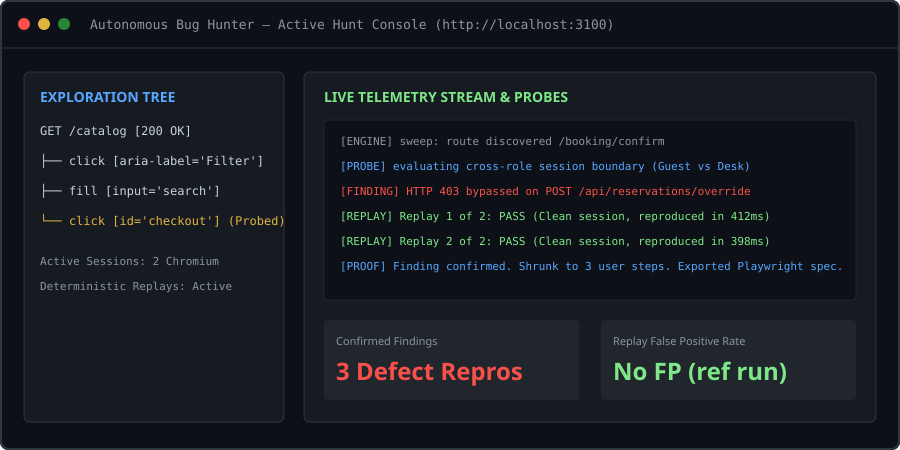
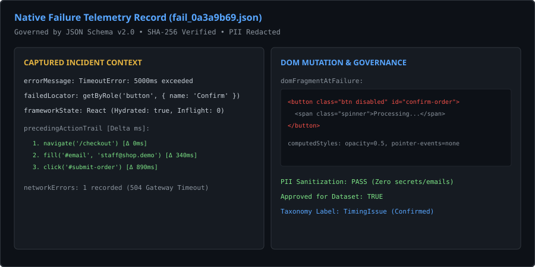
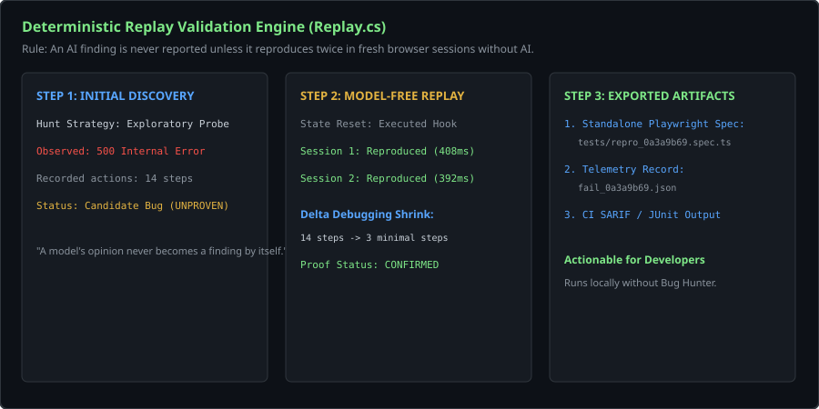
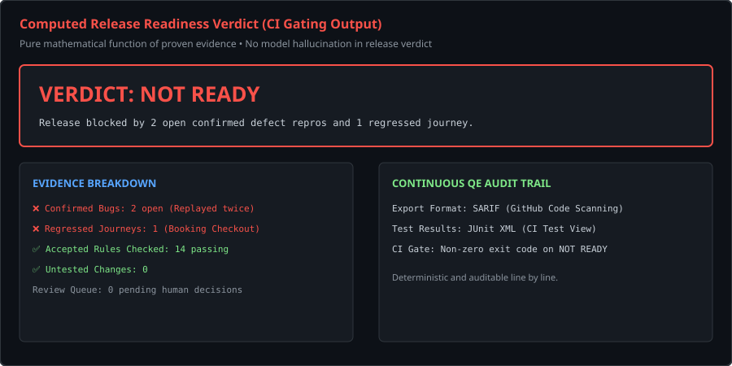
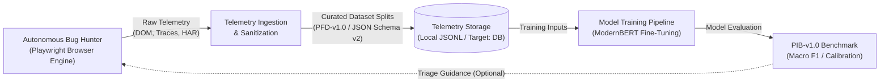
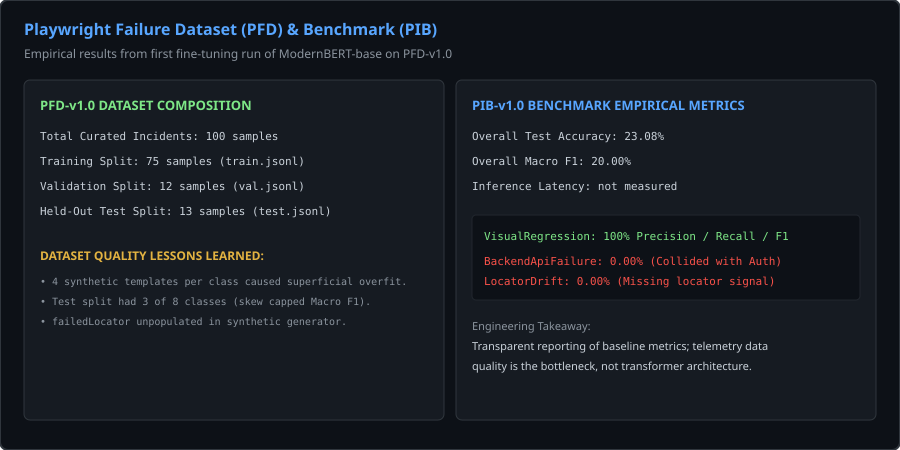

# Autonomous Bug Hunter

[](https://github.com/abul-lab/Autonomous-Bug-Hunter-Playwright/actions/workflows/ci.yml)
[](LICENSE)
[](docker-compose.yml)
[](tests/)

> ### ⚡ 30-Second Overview for Engineers
> - **What is ABH?** An evidence-based continuous QE platform that drives Playwright browser sessions, captures raw failure telemetry, and extracts canonical bug datasets.
> - **What works today?** Deterministic Playwright exploration, model-free double-replay defect confirmation, structured failure telemetry ingestion (`/api/failure-intelligence/ingest`), and JSON Schema v2.0 dataset curation (`PFD-v1.0`).
> - **What is experimental?** Transformer-based root-cause classification (`PIM-RC-v1`, baseline 20.00% Macro F1), and automated AST locator healing.
> - **How to run in 60s?** `node scripts/dev.mjs` (starts Web UI on `:3100` and API on `:5280`).

**An evidence-based, continuous quality-engineering (QE) system and failure intelligence platform for web applications.** It explores applications in a real Playwright browser, records rich failure telemetry (DOM mutations, action trails, network waterfalls, exception stacks), and confirms defects only through model-free double-replay.

> **Core Principle: AI proposes, the engine verifies.**  
> Models propose candidate intents, exploration paths, and rules. Deterministic code decides what constitutes a bug based on recorded evidence, and replays it without any model in the loop. A model's opinion never becomes a finding on its own.

---

## System Architecture & Workflow Illustrations

| Active Exploration & Probing | Rich Failure Telemetry Ingestion |
|:---:|:---:|
|  |  |
| *Conceptual architecture diagram: live browser session explorer, boundary probe injection, and confirmation pipeline.* | *Conceptual schema illustration: JSON Schema v2.0 incident telemetry with DOM fragments, action trails, and sanitized error traces.* |

| Deterministic Replay Verification | Computed Release Readiness Gate |
|:---:|:---:|
|  |  |
| *Conceptual workflow diagram: model-free double-replay verification in clean browser sessions and delta debugging shrinking.* | *Conceptual workflow diagram: evidence-based readiness verdict (Ready / At Risk / Not Ready) with SARIF and JUnit CI exports.* |

---

## Why It Exists

Modern QE teams face three chronic failure modes in test automation:

1. **The Test-Oracle Problem:** Traditional record-and-assert tests assert what an application currently does, turning today's silent bugs into tomorrow's expected behavior. Expectations must stem from intent (stories, specs, roles), not observed state.
2. **Unprovable AI Hallucinations:** Generative AI testing agents that report "this looks wrong" create triage toil and erode engineering trust. A finding is only actionable if it reproduces reliably with minimal steps and recorded traffic.
3. **No Memory Between Runs:** Ad-hoc test suites start from scratch on every run, unable to identify what changed since the last release, forcing teams to blindly retest everything or rely on guesswork.

Autonomous Bug Hunter addresses these gaps with a versioned **Digital Twin** of the application, intent-derived rules, and mandatory replay proof.

---

## Architecture: Closed-Loop Continuous QE

ABH bridges deterministic test execution with automated failure intelligence:



### Primary Asset: Telemetry, Dataset Generation, and Evidence Collection

> [!IMPORTANT]
> **Telemetry Over Model:** The primary engineering asset of this platform is the **telemetry extraction, sanitization, and structured dataset pipeline**. The machine learning model is an optional downstream consumer. ABH remains the sole system of record.

### Local Development vs. Production Deployment

| Dimension | Current Local Implementation | Target Production Architecture |
|---|---|---|
| **System of Record** | Autonomous Bug Hunter (ABH) Engine | Autonomous Bug Hunter (ABH) Engine |
| **Telemetry Storage** | Local JSON/JSONL records (`ai/datasets/raw/`, `ai/datasets/splits/`) | Enterprise Relational Database (PostgreSQL) + Object Store Data Lake |
| **Dataset Generation** | Platform CLI scripts (`collector.py`, `sanitizer.py`, `splitter.py`) | Distributed Workers (Kafka / Temporal pipelines) |
| **Model Training** | Local Python scripts (`train_pim_rc.py`) | Cloud GPU Training Clusters (Kubernetes / Slurm) |
| **Distribution** | Optional Hugging Face Hub export package | Optional Hugging Face Hub export package |

---

## Current State vs. Future Vision

To maintain engineering transparency, the table below clearly delineates what is verified and operational today versus what is planned for future releases:

| System Capability | Current State (What Works Today) | Future Vision (Engineering Roadmap) |
|---|---|---|
| **Browser Exploration** | Autonomous sweep, route mapping, and intent execution in Playwright. | Multi-tab session synchronization and canvas-rendered UI interaction. |
| **Defect Verification** | Mandatory double-replay in clean browser sessions; delta debugging shrinking to minimal repro steps; Playwright spec export. | Automated pull requests with AST-level self-healing locator patches. |
| **Failure Telemetry** | Captures un-truncated exceptions, DOM mutations, preceding action trails, and network status via `/api/failure-intelligence/ingest`. | Distributed streaming telemetry ingestion via OpenTelemetry collectors. |
| **Dataset Governance** | 100 canonical failure incidents validated under JSON Schema v2.0 (`PFD-v1.0`), PII-redacted, and cryptographically hashed. | Larger and more diverse telemetry datasets collected from real-world and open-source applications. |
| **Failure Classification** | ModernBERT fine-tuning pipeline (`PIM-RC-v1`) and fast heuristic triage engine. | Multi-task transformer handling simultaneous root-cause classification, similarity clustering, and locator repair. |
| **Release Gating** | Evidence-based readiness verdict (Ready / At Risk / Not Ready), SARIF export, and JUnit CI reporting. | Automated policy gating with statistical risk confidence intervals. |
| **Knowledge Sync** | Local file specifications and REST simulators for Jira and Confluence (`src/Simulators`). | Production Jira Cloud and Confluence webhooks with semantic AST diffing. |

---

## Playwright Intelligence: Empirical Findings & Lessons Learned

Autonomous Bug Hunter includes the **Playwright Failure Dataset (PFD)**, the **Playwright Intelligence Benchmark (PIB)**, and the first baseline model, **PIM-RC-v1**.

  
*Conceptual diagram: PFD-v1.0 split distribution and empirical baseline evaluation metrics.*

### Empirical Baseline Results (`PIM-RC-v1`)
- **Backbone Architecture:** `answerdotai/ModernBERT-base` (149M parameters, 8,192 token context window)
- **Dataset:** `PFD-v1.0` (75 train, 12 val, 13 held-out test)
- **Taxonomy:** 8 failure classes (`AssertionFailure`, `AuthenticationFailure`, `BackendApiFailure`, `EnvironmentFailure`, `LocatorDrift`, `TestDataFailure`, `TimingIssue`, `VisualRegression`)
- **Overall Metrics:** Test Accuracy: **23.08%** | Macro F1: **20.00%** | Expected Calibration Error (ECE): **0.32**
- **Highlight:** `VisualRegression` achieved **100% Precision, Recall, and F1**.

### Hard Truths: Why Macro F1 Was 20%
Rather than presenting inflated numbers, our post-mortem revealed four explicit data engineering challenges:
1. **Held-Out Test Split Class Skew:** The held-out test split of 13 records contained only 3 of the 8 classes (`VisualRegression` [3], `BackendApiFailure` [3], `LocatorDrift` [7]). Five classes had zero representation in the test split, mathematically capping the maximum possible Macro F1 at 37.5%.
2. **Synthetic Template Cloning:** The initial synthetic dataset relied on 4 fixed templates per class. The model memorized superficial status phrases (`Request failed with status code`) rather than learning invariant failure semantics, causing confusion between API failures and authentication errors.
3. **Depleted Field Signals:** The `failedLocator` field was unpopulated across synthetic records, depriving the transformer of the primary discriminating signal for `LocatorDrift`, while user action trails were identical across 4 separate categories.
4. **Under-Trained Classification Head:** Fine-tuning on CPU for 30 steps with a conservative learning rate (2e-5) left the freshly initialized linear head partially converged.

*See [PIM-RC-v1 Results & Lessons Learned](docs/results-and-lessons-learned.md) for the complete data post-mortem and the roadmap for improving dataset quality, benchmark coverage, and model performance.*

---

## Quick Start

### Prerequisites
- [.NET 9 SDK](https://dotnet.microsoft.com/download/dotnet/9.0)
- [Node.js 20+](https://nodejs.org/)
- Python 3.10+ (optional, only for ML training and benchmark evaluation)

### Local Launch (All Services)

```bash
# 1. Install dependencies
npm --prefix src/web install
npm --prefix src/browser-worker install

# 2. Build and launch all services
node scripts/dev.mjs
```

### Local Services & Ports

| Service | Port / URL | Description |
|---|---|---|
| **Web UI** | [http://localhost:3100](http://localhost:3100) | Next.js Dashboard & Management Console |
| **API & OpenAPI Docs** | [http://localhost:5280/docs](http://localhost:5280/docs) | Core .NET 9 API & Swagger Specification |
| **Demo Shop** | [http://localhost:5290](http://localhost:5290) | Target e-commerce application with switchable defects |
| **Demo Hotel** | [http://localhost:5291](http://localhost:5291) | Target booking application with seeded business logic flaws |
| **Simulators** | [http://localhost:5292](http://localhost:5292) | Jira & Confluence REST mock simulators |

### CLI & ML Pipeline Commands

```bash
# Execute local unit & integration test suite (95 tests)
dotnet test BugHunter.sln

# Run turnkey root-cause inference on a raw failure incident
python ai/pipelines/predict.py --input ai/datasets/raw/fail_0a3a9b69.json

# Run benchmark evaluation against PIB-v1.0
python ai/benchmarks/pib_evaluator.py --split ai/datasets/splits/PFD-v1.0/test.jsonl
```

### Docker

```bash
node scripts/env.mjs          # generates local development keys in .env
docker compose up --build
```

---

## Verified Evidence & System Health

What is claimed in this repository is verified against ground-truth suites and unit tests:

- **95 Automated Tests:** 100% passing across the digital twin graph, failure ingestion, deterministic replay, AST healing, and project workflows.
- **Two Switchable Ground-Truth Apps:** `src/DemoShop` (10 seeded defects) and `src/DemoHotel` (8 seeded business-rule defects).
- **Zero-AI Verification:** Finding validity is measured with all seeded defects turned off; the recorded no-AI reference run had no false positives (see [status report](docs/status-report.md)).
- **Portable & Secure:** Zero hardcoded keys, zero private tokens, zero external database dependencies for local execution.

---

## Documentation Index

| Topic | Document | Focus |
|---|---|---|
| **Architecture** | [docs/architecture.md](docs/architecture.md) | Layers, trust boundaries, execution sequence, and telemetry loop |
| **Release Notes** | [docs/release-notes-v1.0.0.md](docs/release-notes-v1.0.0.md) | Official v1.0.0 release summary and security audit report |
| **ADRs** | [docs/adr/](docs/adr/) | Eleven Architecture Decision Records detailing design trade-offs |
| **Empirical Results** | [docs/results-and-lessons-learned.md](docs/results-and-lessons-learned.md) | PIM-RC-v1 post-mortem, confusion matrix, and data engineering roadmap |
| **Benchmarks** | [docs/BENCHMARKS.md](docs/BENCHMARKS.md) | PIB-v1.0 specification, ground-truth suites, and reproduction commands |
| **Reference Run** | [docs/reference-run.md](docs/reference-run.md) | Two-sprint walkthrough: what was caught, what was missed, and lessons learned |
| **System Limits** | [docs/limits.md](docs/limits.md) | Known protocol, state, and authentication boundaries |
| **Security Model** | [docs/security.md](docs/security.md) | Threat model, secret masking, and vulnerability reporting |

---

## License

Licensed under the [MIT License](LICENSE). Copyright (c) 2026 abul-lab.
