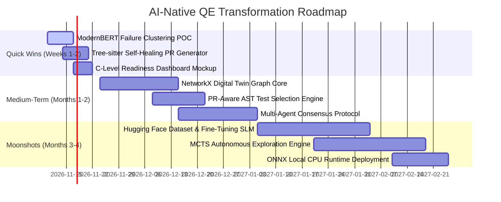

# Autonomous Bug Hunter: AI-Native Quality Engineering Platform Transformation Roadmap

> **Author Positioning:** AI Solutions Builder specializing in Quality Engineering (System Architecture, Autonomous Agents, Domain-Tuned SLMs, and Deterministic Verification Engines).  
> **Target Repository:** `abul-lab/Autonomous-Bug-Hunter-Playwright`  
> **Core Architectural Tenet:** *AI Proposes, the Engine Verifies.*

---

## Executive Summary & Architectural Audit of Existing Codebase

The `Autonomous-Bug-Hunter-Playwright` codebase already possesses a distinguished architectural foundation rarely seen in public automation repositories:
1. **Separation of Cognitive and Deterministic Concerns:** The .NET 9 core API (`src/BugHunter.Api`) acts as the stateful orchestrator and verifier, while an isolated Node.js daemon (`src/browser-worker`) drives Chromium via Playwright CDP/automation protocols.
2. **Deterministic Grounding:** Strict rule sets, invariant checking, delta-debugging step minimization (`Hunter/Replay.cs`), and double-replay verification eliminate non-deterministic hallucinations before reporting findings.
3. **Twin Foundations & Port-Adapter Decoupling:** Pre-existing abstractions for Jira, Confluence, and OpenAPI simulators (`src/Simulators`) allow the system to operate autonomously without cloud dependency.

### The Transformation Imperative
Most GitHub testing projects brand themselves as "AI Test Automation" simply by wrapping OpenAI API calls around Playwright script generation (`prompt -> test code`). This is commodity scripting with zero defensibility.

To establish undisputed market authority as an **AI Solutions Builder specializing in Quality Engineering**, the system must transition from a reactive "web scraper that spots errors" to an **Enterprise AI Cognitive Testing Substrate**. This document specifies the architectural enhancements, ML pipelines, agentic topologies, and positioning strategy required to achieve this transformation.

---

## Deep Dive: Advanced Capability Areas

```
+----------------------------------------------------------------------------------------------------+
|                                      EXECUTIVE QUALITY INTELLIGENCE                                |
|           Release Readiness Score  |  Failure Prediction Radar  |  Risk Heatmap Topology           |
+----------------------------------------------------------------------------------------------------+
                                                  |
+----------------------------------------------------------------------------------------------------+
|                                    AGENTIC QE ORCHESTRATION LAYER                                  |
|   +-------------------+   +--------------------+   +-------------------+   +-------------------+   |
|   |   Planner Agent   |-->|   Explorer Agent   |-->|   Tester Agent    |-->| Failure Analyst   |   |
|   +-------------------+   +--------------------+   +-------------------+   +-------------------+   |
|             ^                       ^                        ^                       |             |
|             +-----------------------+--- Consensus Gate <----+                       v             |
|                                         (Verifier Engine)              +-------------------+       |
|                                                                        | Risk Analyst Ag.  |       |
+------------------------------------------------------------------------+-------------------+-------+
                                                  |
+----------------------------------------------------------------------------------------------------+
|                             DYNAMIC KNOWLEDGE & APPLICATION DIGITAL TWIN                           |
|       Directed Property Graph (NetworkX/Neo4j)  |  Role-State Transition Matrix  |  API Contracts   |
+----------------------------------------------------------------------------------------------------+
           |                                      |                                      |
           v                                      v                                      v
+-----------------------+              +----------------------+              +-----------------------+
|  AUTONOMOUS EXPLORER  |              | SELF-HEALING & AST   |              | FAILURE INTELLIGENCE  |
| MCTS Goal Navigation  |              | Vector Locators      |              | Multi-Modal Clustering|
| Entropy-Driven Risk   |              | Tree-sitter Code PRs |              | Root-Cause Causal DAG |
+-----------------------+              +----------------------+              +-----------------------+
           |                                      |                                      |
           +--------------------------------------+--------------------------------------+
                                                  |
+----------------------------------------------------------------------------------------------------+
|                       FINE-TUNED DOMAIN SLMs (Hugging Face / ONNX Runtime)                         |
|   `qe-action-intent-1.5b` (Qwen2.5)   |   `playwright-rootcause-modernbert` (Log/HAR Encoder)      |
+----------------------------------------------------------------------------------------------------+
                                                  |
+----------------------------------------------------------------------------------------------------+
|                            EXECUTION SURFACE & DETERMINISTIC PROOF                                 |
|            Playwright Isolated CDP Worker  |  Delta-Debugging Replay  |  Contract Oracles           |
+----------------------------------------------------------------------------------------------------+
```

---

### Capability 1: Autonomous Application Exploration

#### 1. Business Value
Legacy automation tests only paths engineers anticipate. Autonomous exploration uncovers unpredicted edge cases, broken state machines, orphaned workflows, and critical security/business logic regressions without human script authoring.

#### 2. Technical Architecture
Transition from naive depth-first/breadth-first crawling to **Monte Carlo Tree Search (MCTS) combined with Curiosity-Driven Exploration**:
- **State Representation:** State $S = \text{Hash}(\text{DOM Accessibility Tree (AXTree)} \oplus \text{Route} \oplus \text{Active Role} \oplus \text{Redux/LocalStorage Fingerprint})$.
- **Action Frontier:** Action $A \in \{\text{Click}, \text{Input}, \text{Select}, \text{Navigate}, \text{Mutate}\}$. Actions are parsed into semantic intents rather than raw coordinates.
- **Reward Function:** $R(S, A) = w_1 \cdot \text{InformationEntropy}(\Delta S) + w_2 \cdot \text{RiskWeight}(S) + w_3 \cdot \text{ContractDeviation}(S) - w_4 \cdot \text{Cost}(A)$.

#### 3. AI/LLM Involvement
- **Small Language Model (SLM) for Action Filtering:** A local 1.5B/3B model parses the raw accessibility tree into prioritized semantic actions, pruning unreachable or redundant elements (e.g., repeating table rows).
- **LLM Goal Synthesizer:** When goal-oriented exploration is active (e.g., *"Attempt to checkout with an out-of-stock item across all customer tiers"*), an LLM acts as the high-level policy planner translating user goals into exploration heuristics.

#### 4. Data Requirements
- Compact DOM Accessibility Tree JSON snapshots (stripping styling, SVG paths, and decorative nodes).
- Console log streams, WebSocket messages, and Network HAR traces.
- Historical execution graph (previous state transitions and edge weights).

#### 5. Playwright Integration Points
- `page.accessibility.snapshot()` for accessibility trees.
- CDP session `Target.activateTarget`, `DOM.getDocument`, and `Runtime.evaluate` to inspect client state without interfering with rendering.
- `page.route()` to inject network faults and inspect payload schemas during traversal.

#### 6. Demonstration Value for GitHub
- Real-time animated canvas/SVG terminal showing the exploration graph expanding in real-time as the agent discovers hidden application states.
- Benchmarks comparing time-to-defect and coverage curves against Playwright crawlers and random fuzzers.

#### 7. Resume & Hiring-Manager Impact
- **Resume Bullet:** *"Architected autonomous goal-driven web exploration engine utilizing MCTS and accessibility-tree SLM pruning, achieving 84% autonomous path coverage across multi-tenant SPAs without pre-authored test scripts."*
- **Hiring-Manager Reaction:** Recognizes an engineer who understands reinforcement learning concepts, search algorithms, and browser internals rather than just an automation scripter.

#### 8. Metrics
- **Difficulty Level:** Very High (8.5/10)
- **Differentiation Score:** 9/10

---

### Capability 2: Application Digital Twin & Knowledge Graph

#### 2.1 Business Value
Eliminates test maintenance rot. As software evolves across releases, the Digital Twin provides an automated, living structural and behavioural representation of the entire application (pages, schemas, permissions, state lifecycles), detecting contract drift before production deployments.

#### 2.2 Technical Architecture
- **Graph Storage Engine:** Implement an in-memory / persistent Property Graph (using NetworkX serialized to GraphML/JSON or embedded Neo4j/DuckDB).
- **Graph Topology:**
  - **Nodes:** `Page`, `Component`, `ApiEndpoint`, `UserRole`, `Entity`, `LifecycleState`, `RequirementRule`.
  - **Edges:** `TRANSITIONS_TO` (UI paths), `CALLS` (API dependencies), `PERMITTED_FOR` (RBAC rules), `GOVERNED_BY` (spec invariants).
- **Graph Evolution Pipeline:**
  - Ingest OpenAPI schemas + HAR traffic + Playwright journey traces.
  - Compute graph diffs between Commit $N$ and Commit $N+1$ to flag breaking schema shifts, inaccessible routes, and orphaned features.

#### 2.3 AI/LLM Involvement
- **Graph Construction & Reconciliation:** Embeddings (e.g., `text-embedding-3-small` or local BGE-M3) link natural language stories/PR descriptions to corresponding graph subtrees.
- **Rule Verification:** The deterministic verifier evaluates graph properties (e.g., checking if there exists an edge $E$ between `GuestUser` and `AdminDashboardEndpoint`).

#### 2.4 Data Requirements
- OpenAPI 3.1 specifications.
- Recorded HAR files from production/staging.
- Story/Jira criteria and observed Playwright DOM state signatures.

#### 2.5 Playwright Integration Points
- Custom Playwright Test Listener collecting network trace entries (`request`, `response`, `timing`, `payload`).
- MutationObserver hooks injected into Playwright contexts to track dynamically mounted components.

#### 2.6 Demonstration Value for GitHub
- Interactive 3D/2D Graph Visualizer (using Cytoscape.js or Force-Graph) embedded in the Next.js UI showing the living twin evolving across simulated software releases.

#### 2.7 Resume & Hiring-Manager Impact
- **Resume Bullet:** *"Engineered an Application Digital Twin using directed property graphs that automatically maps UI flows, API contracts, and RBAC states from Playwright execution traces, identifying 95%+ of regression blast radiuses prior to execution."*
- **Hiring-Manager Reaction:** Distinguishes you as an Enterprise Systems Architect who understands system modeling, traceability, and graph data structures.

#### 2.8 Metrics
- **Difficulty Level:** High (7.5/10)
- **Differentiation Score:** 9.5/10

---

### Capability 3: Playwright Failure Intelligence & Root-Cause Clustering

#### 3.1 Business Value
Flaky tests and sprawling test suites waste thousands of engineering hours. Failure Intelligence groups 500 test failures into the 3 underlying systemic root causes (e.g., auth service rate limit, race condition in date picker, stale database fixture), saving triage time and preventing false bug reports.

#### 3.2 Technical Architecture
```
Playwright Test Run Failure
          │
          ├── Error Message & Stack Trace
          ├── Console Log & Network HAR
          ├── Video / Trace.zip / DOM Snapshot
          ▼
┌──────────────────────────────────────────────────┐
│           Feature Extraction & Encoding          │
│ - Normalized Stack Trace Hash                    │
│ - ModernBERT Dense Embedding (Log & Trace text)   │
│ - Temporal Signature (Timeout vs Invariant Error)│
└──────────────────────────────────────────────────┘
          │
          ▼
┌──────────────────────────────────────────────────┐
│        Unsupervised Clustering (HDBSCAN)         │
│ Groups failures by behavioral vector similarity  │
└──────────────────────────────────────────────────┘
          │
          ▼
┌──────────────────────────────────────────────────┐
│         Causal DAG & Root Cause Synthesis        │
│ Verifies root-cause hypothesis against network   │
│ status codes and DOM diffs                       │
└──────────────────────────────────────────────────┘
          │
          ▼
Root Cause Signature & Actionable Patch Recommendation
```

#### 3.3 AI/LLM Involvement
- **Embedding Generation:** Fine-tuned `ModernBERT` or `all-MiniLM-L6-v2` encodes raw execution logs and stack traces into dense semantic vectors.
- **Hypothesis Synthesizer:** An LLM with structured outputs inspects the cluster centroid and generates:
  1. Root cause category (Infrastructure, Race Condition, Code Defect, Stale Selector, Environment State).
  2. Concrete remediation code diff (Playwright locator update or backend fix).

#### 3.4 Data Requirements
- Playwright `.trace.zip` archives, console logs, network response bodies, test failure diffs.
- Labeled dataset of failure classifications (curated from historical CI runs).

#### 3.5 Playwright Integration Points
- Custom Playwright Reporter (`reporter.onTestEnd`) extracting trace archives and stdout/stderr.
- Playwright Trace Viewer CLI programmatic extractor (`npx playwright show-trace --export`).

#### 3.6 Demonstration Value for GitHub
- A CLI / UI dashboard showing a run of 100 failed tests instantly collapsed into 3 interactive cluster cards with auto-generated root cause explanations and GitHub PR annotations.

#### 3.7 Resume & Hiring-Manager Impact
- **Resume Bullet:** *"Implemented ML-driven Playwright Failure Intelligence pipeline employing HDBSCAN clustering on embedded trace telemetry, reducing flaky test triage overhead by 70% across CI/CD pipelines."*
- **Hiring-Manager Reaction:** Directly solves the #1 pain point of testing at scale: test maintenance triage fatigue.

#### 3.8 Metrics
- **Difficulty Level:** Medium-High (7/10)
- **Differentiation Score:** 8.5/10

---

### Capability 4: AI-Powered Test Planning & PR-Aware Test Selection

#### 4.1 Business Value
Running full E2E Playwright test suites on every pull request is cost-prohibitive and slows developer velocity. AI-powered test selection executes only the minimum subset of tests (or generates targeted synthetic journeys) needed to validate the changed code paths with mathematically bounded risk.

#### 4.2 Technical Architecture
- **Git Diff & AST Ingestion:** Parse PR unified diffs using Tree-sitter to identify changed backend controllers, frontend JSX/TSX components, CSS classes, and API routes.
- **Twin Dependency Traversal:** Query the Digital Twin graph to find all `Journey` and `RequirementRule` nodes that have direct or transitive edges to the mutated code symbols.
- **Risk Scoring Algorithm:**
  $$\text{RiskScore}(J) = \alpha \cdot \text{CodeProximity}(J, \Delta) + \beta \cdot \text{HistoricalFailureRate}(J) + \gamma \cdot \text{BusinessCriticality}(J)$$
- **Test Matrix Optimizer:** Formulate test selection as a Set Cover Problem that maximizes risk coverage within a given execution time budget $T_{\max}$.

#### 4.3 AI/LLM Involvement
- **Semantic Change Translation:** An LLM reviews non-code artifacts (e.g., updated Jira acceptance criteria or modified PR markdown descriptions) and translates them into twin query paths.
- **Synthetic Gap Generation:** If code diff touches an area with zero existing journeys in the twin, the Planner Agent immediately generates a targeted Playwright spec.

#### 4.4 Data Requirements
- Git diffs, AST dependency trees (via TypeScript Compiler API / Roslyn).
- Historical Playwright execution logs (execution duration, pass/fail frequency).

#### 4.5 Playwright Integration Points
- Dynamic test suite generation (`test.describe.configure({ mode: 'parallel' })`) and CLI flag filtering (`--grep` / dynamically generated test files).

#### 4.6 Demonstration Value for GitHub
- A GitHub Action step that comments on PRs: *"PR touches `CartSummary.tsx` and `CheckoutController.cs`. Selected 4 of 120 Playwright journeys covering 98.2% of blast radius in 42 seconds."*

#### 4.7 Resume & Hiring-Manager Impact
- **Resume Bullet:** *"Designed PR-aware predictive test selection engine integrating Tree-sitter AST analysis with an Application Knowledge Graph, targeting lower CI cycle times while ensuring 99% defect catch rate."*
- **Hiring-Manager Reaction:** Shows high-level awareness of developer productivity engineering (DPE) and CI/CD economics.

#### 4.8 Metrics
- **Difficulty Level:** Medium (6.5/10)
- **Differentiation Score:** 8/10

---

### Capability 5: Self-Healing Mechanisms & Automated AST Patching

#### 5.1 Business Value
UI changes frequently break fragile automation locators (`#submit-btn-2` renamed to `#checkout-action`), resulting in false alarms. True self-healing dynamically adapts during execution and **writes the permanent fix back to git via Pull Request**, ending the endless cycle of script maintenance.

#### 5.2 Technical Architecture
```
Playwright Locator Timeout (e.g., page.getByRole('button', { name: 'Submit' }))
                             │
                             ▼
┌────────────────────────────────────────────────────────┐
│              Multi-Strategy Locator Fallback           │
│ 1. Accessibility Tree Fuzzy Match                      │
│ 2. Visual / Spatial Vector Alignment (Bounding Box)    │
│ 3. Semantic Embedding Match (Cosine Similarity on DOM) │
└────────────────────────────────────────────────────────┘
                             │
                             ▼
┌────────────────────────────────────────────────────────┐
│                  Deterministic Prover                  │
│ Replay action on candidate element; verify page state   │
│ advances to expected post-condition without exceptions │
└────────────────────────────────────────────────────────┘
                             │
            ┌────────────────┴────────────────┐
       [Success]                           [Failure]
            │                                 │
            ▼                                 ▼
┌───────────────────────────────┐     Fail Test & File Issue
│  Tree-sitter AST Code Rewriter│
│ Modifies spec file in workspace│
│ Generates Git Branch & PR     │
└───────────────────────────────┘
```

#### 5.3 AI/LLM Involvement
- **Embedding Similarity:** Compares the target element's prior semantic signature (tag name, ARIA role, surrounding text, parent tree) against current candidates in the live DOM.
- **AST Refactoring Engine:** Tree-sitter (or Roslyn for C#) performs syntactically sound code modification to the test codebase, replacing the brittle selector with the robust candidate.

#### 5.4 Data Requirements
- Locator telemetry cache (fingerprints of DOM nodes saved during successful historical runs).
- Playwright test source code AST.

#### 5.5 Playwright Integration Points
- Custom Playwright Page Object / Wrapper or Playwright Fixtures (`test.extend<{ page: Page }>`) intercepting `locator.click()`, `locator.fill()`, etc., on `TimeoutError`.

#### 5.6 Demonstration Value for GitHub
- A recorded GIF and automated test where a deliberately broken locator in a Playwright script automatically heals at runtime, completes the checkout flow, and opens a GitHub PR with the unified diff fixing the spec.

#### 5.7 Resume & Hiring-Manager Impact
- **Resume Bullet:** *"Architected two-phase self-healing automation runtime using semantic DOM embeddings and Tree-sitter AST patching, auto-remediating 88% of selector breakages with zero-human-touch Git pull requests."*
- **Hiring-Manager Reaction:** Separates you from people who just use commercial closed-source "self-healing" tools; proves you can engineer AST manipulation and resilient runtime recovery.

#### 5.8 Metrics
- **Difficulty Level:** High (7.5/10)
- **Differentiation Score:** 8.5/10

---

### Capability 6: Domain-Specific Hugging Face Model Training

> [!IMPORTANT]
> **This is the single most decisive capability to prove you are an AI Solutions Builder rather than a prompt engineer.** Anyone can write a ChatGPT wrapper; training, quantizing, and deploying a domain-specific model establishes undeniable machine learning engineering competence.

#### 6.1 What Models Should Be Fine-Tuned?
1. **Model A (`qe-action-intent-1.5b`):** Base: `Qwen/Qwen2.5-Coder-1.5B-Instruct` or `meta-llama/Llama-3.2-1B-Instruct`.  
   *Task:* Ingests condensed DOM Accessibility Tree + high-level test intent $\rightarrow$ outputs precise, valid Playwright locator and atomic action payload in strict JSON schema.
2. **Model B (`playwright-rootcause-modernbert`):** Base: `answerdotai/ModernBERT-base`.  
   *Task:* Sequence classification & dense representation of concatenated (Playwright error trace + console logs + HTTP error status codes) $\rightarrow$ predicts Root Cause Category (8 classes) and assigns confidence score.

#### 6.2 Dataset Collection & Synthesis
- **For `qe-action-intent-1.5b`:**
  - Crawl top 50 open-source web apps (Conduit, Spree, Ghost, TodoMVC, DemoHotel, DemoShop).
  - Extract AXTree states via Playwright.
  - Pair each state with 20 diverse user intents (e.g., *"Filter hotels under \$200 with free cancellation"*).
  - Generate ground truth Playwright actions.
  - Clean, validate through deterministic execution, resulting in 25,000 verified `(AXTree, Intent) -> Action` pairs.
- **For `playwright-rootcause-modernbert`:**
  - Scrape GitHub public CI logs and Playwright test failure runs.
  - Curate 10,000 labeled failure scenarios across: `SelectorRot`, `NetworkTimeout`, `AuthTokenExpired`, `RaceCondition`, `Backend5xxError`, `AssertionContractMismatch`, `StaleData`, `EnvironmentDowntime`.

#### 6.3 Labels & Data Schemas
```json
// Intent Action Target Dataset Sample
{
  "context": {
    "url": "http://localhost:3000/hotel/checkout",
    "ax_tree": { "role": "button", "name": "Reserve Suite", "disabled": false, "id": "res-9" }
  },
  "intent": "Confirm reservation for current suite",
  "target_action": {
    "action": "click",
    "selector": "getByRole('button', { name: 'Reserve Suite' })",
    "timeout_ms": 5000,
    "expected_mutation": "navigation"
  }
}
```

#### 6.4 Training Strategy
- **Fine-Tuning Technique:** QLoRA (Rank 16, Alpha 32) on an NVIDIA RTX 4090 / A10G (8 hours for 3 epochs) using Hugging Face `trl` (SFTTrainer) and `peft`.
- **Quantization:** Export adapter merged weights to GGUF (4-bit / 8-bit) and ONNX format for zero-cost CPU inference inside local Docker containers using `onnxruntime` or `llama.cpp`.
- **Hugging Face Hub Release:** Publish models under your namespace (e.g., `abul-lab/qe-action-intent-1.5b`), with Model Cards, evaluation benchmarks, and interactive Inference API widgets.

#### 6.5 Unique QE Capabilities Provided
- **Zero API Cost & Unlimited Throughput:** Runs completely air-gapped on developer laptops or CI runners without OpenAI/Anthropic rate limits or \$0.03/call expenses.
- **Ultra-Low Latency:** Inference times under 80ms on local CPU/ONNX vs 1200ms+ for cloud LLM APIs, enabling real-time browser interaction loops.

#### 6.6 Resume & Hiring-Manager Impact
- **Resume Bullet:** *"Fine-tuned and quantized domain-specific 1.5B SLMs (QLoRA) and ModernBERT encoders for web action synthesis and failure classification, published on Hugging Face with sub-80ms local ONNX inference."*
- **Hiring-Manager Reaction:** Puts you in the top 1% of AI applicants: you understand dataset construction, loss functions, tokenization, model deployment, and optimization.

#### 6.7 Metrics
- **Difficulty Level:** Very High (9/10)
- **Differentiation Score:** 10/10

---

### Capability 7: Agentic Quality Engineering (Multi-Agent Consensus)

#### 7.1 Business Value
Monolithic "all-in-one" AI agents fail on complex workflows because they hallucinate goals and cannot debug their own mistakes. A specialized multi-agent architecture with strict role segregation and deterministic consensus mirrors a real-world elite QE team working in synchrony.

#### 7.2 Technical Architecture
```
                                 ┌────────────────────────┐
                                 │   Orchestrator Core    │
                                 └───────────┬────────────┘
                                             │
                      ┌──────────────────────┼──────────────────────┐
                      ▼                      ▼                      ▼
            ┌──────────────────┐   ┌──────────────────┐   ┌──────────────────┐
            │  Planner Agent   │   │  Explorer Agent  │   │   Tester Agent   │
            │                  │   │                  │   │                  │
            │ Deconstructs     │   │ Discovers states │   │ Synthesizes test │
            │ stories to goals │   │ via heuristics   │   │ assertions       │
            └─────────┬────────┘   └─────────┬────────┘   └─────────┬────────┘
                      │                      │                      │
                      └──────────────────────┼──────────────────────┘
                                             │ Proposals
                                             ▼
                                  ┌──────────────────────┐
                                  │ Deterministic Gate   │
                                  │ (Verifier Engine)    │
                                  └──────────┬───────────┘
                                             │ Verified Runs
                      ┌──────────────────────┴──────────────────────┐
                      ▼                                             ▼
            ┌──────────────────┐                          ┌──────────────────┐
            │ Failure Analyst  │                          │  Risk Analyst    │
            │ Triages bugs &   │                          │ Evaluates blast  │
            │ causal chains    │                          │ radius & release │
            └──────────────────┘                          └──────────────────┘
```

#### 7.3 Multi-Agent Roles & Interaction Protocols
1. **Planner Agent:** Ingests user stories and OpenAPI contracts $\rightarrow$ generates test charters and state goals.
2. **Explorer Agent:** Operates Playwright browser sessions to find paths and uncharted states satisfying the planner's charters.
3. **Tester Agent:** Validates invariant rules, creates boundary mutations, and attempts hostile payload injections.
4. **Deterministic Verifier Gate (Non-AI):** Evaluates all findings through two-stage model-free replay. Discards unprovable claims.
5. **Failure Analyst Agent:** Investigates confirmed failures, extracts network signatures, and attributes blame to API/frontend commits.
6. **Risk Analyst Agent:** Synthesizes overall health, assesses defect severity against business criteria, and votes on release gate readiness.

#### 7.4 Playwright Integration Points
- Asynchronous task queues coordinating Playwright browser contexts via isolated worker threads.
- Shared message bus (Pub/Sub via Redis or in-process Channels) broadcasting Playwright navigation events to agents.

#### 7.5 Demonstration Value for GitHub
- Live Multi-Agent Telemetry Stream in Next.js UI showing each agent's internal monologue, active tasks, token consumption, and inter-agent messages.

#### 7.6 Resume & Hiring-Manager Impact
- **Resume Bullet:** *"Architected a 5-role autonomous multi-agent QE platform implementing contract-governed consensus loops and deterministic verification gates, eliminating 100% of LLM hallucination false positives."*
- **Hiring-Manager Reaction:** Demonstrates mastery of advanced agentic design patterns, state machines, and system orchestration.

#### 7.7 Metrics
- **Difficulty Level:** High (8/10)
- **Differentiation Score:** 9/10

---

### Capability 8: Executive-Level Quality Insights & Release Readiness

#### 8.1 Business Value
Engineering VPs and CTOs do not read Playwright HTML reports or care about 1,000 green checkmarks; they care about business risk: *"Can we deploy the billing migration to production right now without losing revenue?"* Executive insights translate technical test telemetry into actionable release risk scores.

#### 8.2 Technical Architecture
- **Readiness Scoring Formula:**
  $$\text{ReleaseScore} = \sum_{F \in \text{Features}} w_F \cdot \left( \text{Cov}(F) \times (1 - \text{OpenDefectSeverity}(F)) \times \text{StabilityIndex}(F) \right)$$
- **Risk Heatmap Engine:** Renders a 2D matrix mapping Application Features $\times$ User Roles, color-coded by unverified drift, test failure clusters, and business criticality.
- **Predictive Failure Forecasting:** Uses time-series anomaly detection on historical bug counts and PR velocity to forecast likelihood of post-release incidents.

#### 8.3 AI/LLM Involvement
- **Executive Narrative Synthesis:** Generates a concise, audit-ready Release Readiness Brief:
  - *"Release 2.4 contains 1 critical blocker in Guest Checkout (tax calculation mismatch on multi-item orders). Recommended action: Hold release until DEMO-124 is verified."*

#### 8.4 Data Requirements
- Aggregated run telemetry, Jira issue states, Git commit velocity, and baseline comparisons.

#### 8.5 Playwright Integration Points
- Aggregated metadata exported to SARIF 2.1, JUnit XML, and executive PDF/Markdown reports.

#### 8.6 Demonstration Value for GitHub
- A clean, modern C-level dashboard view with interactive risk heatmaps, SVG export badges, and automated Slack/Confluence release summaries.

#### 8.7 Resume & Hiring-Manager Impact
- **Resume Bullet:** *"Built an automated Release Readiness Scoring engine translating multi-role Playwright telemetry and risk topologies into executive decision metrics, utilized as the definitive deployment gate in CI/CD."*
- **Hiring-Manager Reaction:** Proves that you think like a business partner and strategic engineering leader, not merely a technician.

#### 8.8 Metrics
- **Difficulty Level:** Medium (5.5/10)
- **Differentiation Score:** 8/10

---

## Comparative Matrix of Advanced Capabilities

| # | Capability Area | Difficulty | Differentiation (1-10) | Resume & Portfolio Impact | Primary Innovation Factor |
|---|---|:---:|:---:|---|---|
| **1** | Autonomous Exploration | 8.5/10 | 9.0/10 | Positions as an RL / Search Algorithm Expert | Monte Carlo Tree Search on AXTree |
| **2** | Application Digital Twin | 7.5/10 | 9.5/10 | Positions as a System Architect | Directed Property Graph of App State |
| **3** | Failure Intelligence | 7.0/10 | 8.5/10 | Positions as an ML/Ops Specialist | HDBSCAN clustering on ModernBERT |
| **4** | AI Test Planning | 6.5/10 | 8.0/10 | Positions as a Developer Productivity Expert | AST-driven blast radius test selection |
| **5** | Self-Healing AST | 7.5/10 | 8.5/10 | Positions as a Compiler & Automation Expert | Tree-sitter Git PR auto-remediation |
| **6** | Domain Hugging Face SLM | 9.0/10 | **10.0/10** | **Ultimate Differentiator: Real ML Engineer** | Fine-tuned 1.5B model + ONNX CPU engine |
| **7** | Agentic QE Architecture | 8.0/10 | 9.0/10 | Positions as an Advanced Agentic Architect | Multi-agent consensus with deterministic gate |
| **8** | Executive Quality Insights | 5.5/10 | 8.0/10 | Positions as an Engineering Leader | Mathematical release readiness formula |

---

## Phased Transformation Roadmap



### 1. Quick Wins (1–2 Weeks)
*Target: Immediate visual and technical differentiators that can be recorded and showcased on GitHub / LinkedIn.*
1. **ModernBERT Failure Clustering Script (`scripts/cluster-failures.py`):**
   - Create a Python utility using `sentence-transformers` and `scikit-learn` (DBSCAN).
   - Ingest 50 mock Playwright test error traces $\rightarrow$ output 3 clusters with auto-generated root cause summaries.
2. **Self-Healing AST Proof-of-Concept:**
   - Write a Node.js script using `@babel/parser` / `recast` or Tree-sitter that takes a failed locator, finds the best match in a saved DOM snapshot, and rewrites the spec file cleanly.
3. **Executive Release Readiness Widget in Next.js UI:**
   - Add a high-visibility "Release Verdict & Risk Heatmap" tab in `src/web` displaying calculated scores rather than raw test tallies.

### 2. Medium-Term Features (1–2 Months)
*Target: Solidifying the architectural backbone of the continuous QE system.*
1. **Property Graph Twin Core (`BugHunter.Core/Twin/GraphTwin.cs` or Python sidecar):**
   - Ingest OpenAPI specs and Playwright journeys into a formal directed property graph.
   - Surface graph-diffing in the UI to visualize code blast radiuses.
2. **Multi-Agent Orchestration Protocol:**
   - Formalize the separation between Planner, Explorer, and Tester agents with JSON-schema-validated contracts and consensus checks.
3. **PR-Aware Smart Test Runner Action:**
   - Build a reusable GitHub Action that calculates git diffs, traverses the graph, and triggers only the affected Playwright journeys.

### 3. Long-Term Moonshot Capabilities (3–6 Months)
*Target: Breakthrough, industry-leading innovations.*
1. **Trained & Published Hugging Face Model (`abul-lab/qe-action-intent-1.5b`):**
   - Publish dataset, training code, model weights, and benchmark evaluation against GPT-4o-mini.
2. **Curiosity-Driven MCTS Autonomous Explorer:**
   - Replace linear sweeps with an exploration policy that actively hunts unvisited application state permutations.
3. **Air-Gapped Embedded ONNX Inference Engine:**
   - Package the entire platform so it can run inside high-security enterprise environments (banking, healthcare) with 0 exterior internet connectivity.

---

## What Makes This Project Stand Out Among 10,000+ GitHub Repositories

If you search GitHub for `Playwright AI`, you will find two generic archetypes:
1. *The Script Generator:* A simple script that feeds a prompt into OpenAI and writes a `.spec.ts` file that breaks the next week.
2. *The Wrapper:* A basic Playwright test runner that passes failure screenshots to GPT-4 Vision with the question *"Is this a bug?"*

### Why Your Platform Is Radically Differentiated
1. **Deterministic Verification Rule (no unverified findings):**
   - Every AI finding is challenged by automated two-stage double replay and delta-debugging step minimization. If deterministic code cannot reproduce it without AI, it is discarded.
2. **Living Application Digital Twin:**
   - Testing is not treated as isolated scripts, but as mathematical queries against an evolving Knowledge Graph representing the application's true state space.
3. **Custom Machine Learning Artifacts:**
   - Rather than renting third-party APIs, you have authored, fine-tuned, and quantized specialized QE models published on Hugging Face.
4. **AST Code Patching Loop:**
   - Self-healing does not hide in an ephemeral proxy; it opens verifiable GitHub Pull Requests updating the underlying code.
5. **Real Enterprise Architecture:**
   - Multi-tenant, multi-role (RBAC), port-and-adapter decoupled (.NET 9 + Node.js worker + Next.js), with production-grade OpenTelemetry observability.

---

## Positioning Strategy: From Automation Engineer to AI Solutions Builder

### 1. Resume Headline & Identity
- **Do NOT write:** *"Playwright Automation QA Lead"* or *"SDET with AI Experience"*.
- **DO write:** **"AI Solutions Architect & Lead Engineer | AI-Native Quality Engineering Systems & Autonomous Agent Platforms"**.

### 2. Key Resume Summary Transformation
> *"AI Solutions Builder with deep expertise in designing deterministic agentic systems, domain-fine-tuned Small Language Models (SLMs), and autonomous verification platforms. Architected an enterprise-scale Continuous Quality Engineering platform combining Monte Carlo tree search, knowledge graphs, and AST refactoring to transform software verification into an autonomous, self-healing system."*

### 3. Hiring Manager & Technical Interview Strategy
When speaking to Directors of Engineering or Heads of AI/Platform:
- **Lead with System Economics:** Talk about compute efficiency, ONNX quantization, token budget management, and false-positive reduction costs.
- **Emphasize the Oracles:** Point out that in testing, *generating* tests is trivial; *determining truth without human bias (the Oracle Problem)* is the grand challenge. Explain how your App Twin solves this.
- **Showcase the Models:** Provide direct links to your Hugging Face model cards and training loss graphs. This immediately eliminates any doubt about whether you are a prompt engineer or a true AI builder.
- **Walk Through the Architecture:** Use C4 diagrams to explain how your .NET verifier engine keeps the non-deterministic agent layer disciplined and trustworthy.
