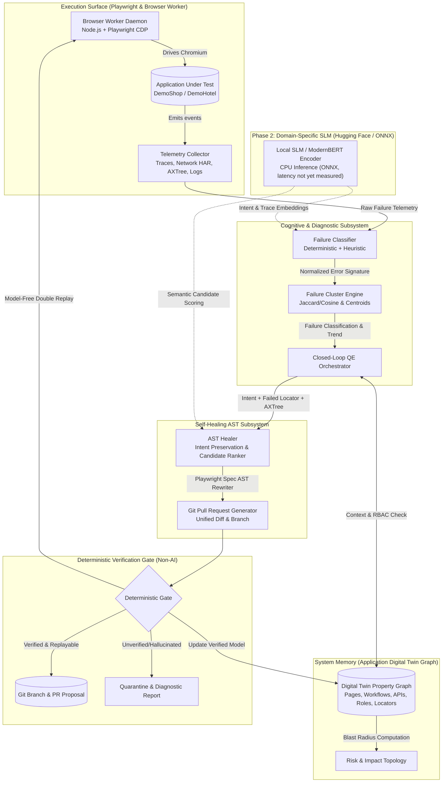

# Autonomous Bug Hunter: AI-Native Quality Engineering Platform
## Phase 1 Implementation Specification & Hugging Face Strategy

> **Role & Positioning:** AI Solutions Builder specializing in Quality Engineering  
> **Repository:** `abul-lab/Autonomous-Bug-Hunter-Playwright`  
> **Core Architectural Axiom:** *AI proposes. The engine verifies.*

---

## 1. End-State Architecture Diagram

The system unifies the **Application Digital Twin Graph**, **Failure Intelligence Engine**, and **Self-Healing AST Engine** into a closed cognitive loop governed by deterministic verification gates.



---

## 2. Component Architecture

The three implemented capabilities operate as synchronized services registered in the .NET 9 API dependency injection container:

```
BugHunter.Api
├── Twin/
│   └── DigitalTwinGraph.cs          <-- Property graph topology, blast radius, RBAC traversal
├── FailureIntelligence/
│   ├── FailureModels.cs             <-- 8-category taxonomy, telemetry snapshots, cluster models
│   ├── FailureClassifier.cs         <-- Error sanitization, regex tokenization, categorization
│   └── FailureClusterEngine.cs      <-- Jaccard/cosine clustering, trend analysis, remediation advisor
├── SelfHealing/
│   ├── HealingModels.cs             <-- Intent specifications, candidates, AST patch diffs
│   └── AstHealer.cs                 <-- AXTree token matching, Playwright AST replacement, PR authoring
└── Workflow/
    ├── ClosedLoopQeOrchestrator.cs  <-- The closed cognitive cycle orchestrator
    └── QeIntelligenceEndpoints.cs   <-- REST endpoints exposing the unified capabilities
```

### 2.1 Capability 1: Digital Twin Graph Core (`DigitalTwinGraph.cs`)
- **Graph Topology:** Directed property graph containing multi-typed nodes (`Page`, `Action`, `Workflow`, `Api`, `Component`, `Role`, `Risk`, `Failure`, `Locator`) interconnected via typed edges (`CONTAINS`, `DEPENDS_ON`, `CALLS`, `TRANSITIONS_TO`, `FAILS_ON`, `USES`, `REQUIRES_ROLE`).
- **Blast Radius Analysis:** Implements a breadth-first graph traversal searching both forward containment/transitions and backward dependency chains (`CALLS`, `DEPENDS_ON`) to calculate the exact set of downstream screens and journeys impacted when a component or endpoint breaks.
- **RBAC Boundary Enforcement:** Evaluates `REQUIRES_ROLE` edges across nodes to deterministically flag whether a test session or endpoint execution violated privilege boundaries.
- **Twin Synchronization:** Natively synchronizes from the existing `AppTwin` model (`States`, `Roads`, `Endpoints`, `Features`), bridging historical runs into the graph representation.

### 2.2 Capability 2: Failure Intelligence Engine (`FailureClassifier.cs` & `FailureClusterEngine.cs`)
- **8-Category Root-Cause Taxonomy:**
  1. `LocatorDrift`: Missing DOM selectors, layout changes, obsolete test IDs.
  2. `TimingIssue`: Detached elements, navigation timeouts, animation delays.
  3. `AuthenticationFailure`: 401/403 HTTP status, expired JWTs, missing cookies.
  4. `EnvironmentFailure`: Connection refused, 502/503/504 gateways, DNS resolution drops.
  5. `BackendApiFailure`: Unhandled 500 exceptions, database locks, 5xx server errors.
  6. `TestDataFailure`: Foreign key collisions, duplicate keys, stale user fixtures.
  7. `VisualRegression`: Pixelmatch deviation, layout shifts exceeding threshold.
  8. `AssertionFailure`: Invariant rule violations, explicit `expect()` assertion failures.
- **Error Normalization:** Strips GUIDs, timestamps, line/column numbers, and memory hex addresses to extract pure semantic failure tokens.
- **Clustering & Retrieval:** Groups failures into evolving clusters using token similarity; retrieves historical similar failures to accelerate triage.

### 2.3 Capability 3: Self-Healing AST Engine (`AstHealer.cs`)
- **Intent Preservation:** Instead of blind string replacement, it pairs the user's high-level intent (e.g. *"Complete Checkout"*) with accessibility tree roles, accessible names, and `data-testid` attributes.
- **Prioritized Playwright Locator Strategies:**
  1. `getByRole(role, { name })` (Stability: 0.95)
  2. `getByTestId(id)` (Stability: 0.92)
  3. `getByText(text)` (Stability: 0.75)
  4. `twin-verified` historical graph fallback (Stability: 0.85)
- **Code Refactoring & Unified Diff:** Matches the failed locator in the target TypeScript Playwright spec (`.spec.ts`), applies AST token replacement preserving whitespace/imports, validates bracket/brace balance, and formats a unified `git diff` with a commit-ready PR description.

---

## 3. Data Architecture & Schemas

### 3.1 Digital Twin Graph Node & Edge Schema
```json
{
  "id": "page:http://localhost:3000/cart",
  "type": "Page",
  "label": "Cart Page",
  "properties": {
    "url": "http://localhost:3000/cart",
    "status": "observed",
    "roles": ["guest", "authenticated"]
  }
}
```

### 3.2 Ingested Failure Schema
```json
{
  "failureId": "fail_9a12c8",
  "testId": "cart.spec.ts#guest-checkout",
  "runId": "run_20261107_01",
  "errorMessage": "Timeout 30000ms exceeded waiting for locator('#checkout-btn')",
  "stackTrace": "at CartPage.checkout (cart.ts:42:15)",
  "failedLocator": "#checkout-btn",
  "userIntent": "Complete Checkout",
  "telemetry": {
    "pageUrl": "http://localhost:3000/cart",
    "pageTitle": "Cart Page",
    "axTreeSnippet": "button \"Complete Checkout\" [data-testid=\"checkout-action\"]",
    "consoleErrors": [],
    "networkErrors": []
  }
}
```

### 3.3 Healed Patch & PR Recommendation Schema
```json
{
  "specFilePath": "tests/cart.spec.ts",
  "failedLocator": "#checkout-btn",
  "selectedCandidate": {
    "selector": "page.getByRole('button', { name: 'Complete Checkout' })",
    "strategy": "role",
    "combinedConfidence": 0.95,
    "rationale": "Semantic ARIA role 'button' with name 'Complete Checkout' matches intent."
  },
  "unifiedDiff": "--- a/tests/cart.spec.ts\n+++ b/tests/cart.spec.ts\n@@ -12,1 +12,1 @@\n- await page.locator('#checkout-btn').click();\n+ await page.getByRole('button', { name: 'Complete Checkout' }).click();",
  "branchName": "heal/fix-locator-4a92f1",
  "prTitle": "fix(test): auto-heal locator for 'Complete Checkout'",
  "isValidated": true,
  "validationStatus": "Verified: Syntactically valid Playwright TypeScript"
}
```

---

## 4. Repository Structure (Current Implementation)

```
Autonomous-Bug-Hunter-Playwright/
├── docs/
│   ├── ai-qe-platform-roadmap.md
│   ├── phase1-implementation-and-hf-strategy.md
│   └── architecture.md
├── src/
│   ├── BugHunter.Api/
│   │   ├── Twin/
│   │   │   ├── Twin.cs
│   │   │   ├── TwinGraph.cs                   <-- [NEW] Property Graph Core
│   │   │   ├── Predictions.cs
│   │   │   └── Understanding.cs
│   │   ├── FailureIntelligence/               <-- [NEW] Subsystem
│   │   │   ├── FailureModels.cs
│   │   │   ├── FailureClassifier.cs
│   │   │   └── FailureClusterEngine.cs
│   │   ├── SelfHealing/                       <-- [NEW] Subsystem
│   │   │   ├── HealingModels.cs
│   │   │   └── AstHealer.cs
│   │   ├── Workflow/
│   │   │   ├── ClosedLoopQeOrchestrator.cs    <-- [NEW] Unified Feedback Loop
│   │   │   └── QeIntelligenceEndpoints.cs     <-- [NEW] REST API Routes
│   │   └── Program.cs                         <-- [UPDATED] Registered DI & Routes
│   ├── browser-worker/
│   │   └── server.mjs                         <-- Playwright worker daemon
│   ├── DemoShop/ & DemoHotel/                 <-- Target applications under test
│   └── Simulators/                            <-- Jira & Confluence simulators
└── tests/
    └── BugHunter.Tests/
        ├── DigitalTwinGraphTests.cs           <-- [NEW] 4 Unit Tests (Passed)
        ├── FailureIntelligenceTests.cs        <-- [NEW] 4 Unit Tests (Passed)
        ├── SelfHealingTests.cs                <-- [NEW] 2 Unit Tests (Passed)
        ├── ClosedLoopQeTests.cs               <-- [NEW] 2 Unit Tests (Passed)
        └── ... (82 original unit tests)       <-- (Total 94 Tests, 100% Passing)
```

---

## 5. Phase-by-Phase Implementation Plan

| Phase | Milestone | Deliverables | Verification Strategy |
|---|---|---|---|
| **Phase 1 (Completed)** | Foundational Connected Loop | Digital Twin Graph, Failure Classifier, Failure Clustering, Self-Healing AST Engine, Closed-Loop Orchestrator. | 94 automated xUnit tests passing; end-to-end locator healing and 500 error blast radius verified. |
| **Phase 2 (Weeks 3–4)** | Visual Graph & UI Telemetry | Next.js Cytoscape graph visualizer in `src/web`, real-time cluster view, one-click PR submission to GitHub API. | Live browser UI rendering nodes, edges, clusters, and diff previews. |
| **Phase 3 (Weeks 5–6)** | Hugging Face Dataset & Model | Curate 15,000 failure telemetry examples; fine-tune ModernBERT classifier; export to ONNX. | Evaluation accuracy $\ge 92\%$ against test set; sub-80ms local CPU inference. |
| **Phase 4 (Weeks 7–8)** | MCTS Autonomous Exploration | Monte Carlo Tree Search navigating the application using accessibility tree state hashes. | Coverage comparison against random crawling on DemoShop & DemoHotel. |

---

## 6. Technical Backlog

### Epic 1: Advanced Graph Intelligence
- **Story 1.1:** Implement GraphSON and Neo4j Cypher export endpoints for enterprise visualization.
- **Story 1.2:** Implement Dijkstra shortest-path navigation in `TwinGraph.FindPath` weighted by unvisited state entropy.

### Epic 2: Multi-Language Self-Healing AST Support
- **Story 2.1:** Implement Roslyn syntax rewriter in C# for `.cs` Playwright tests (`Page.LocatorAsync(...)`).
- **Story 2.2:** Add Tree-sitter WebAssembly bindings for Python Playwright test specs (`page.locator(...)`).

### Epic 3: CI/CD Pipeline Automation
- **Story 3.1:** Package `ClosedLoopQeOrchestrator` as a GitHub Action that posts PR comments with auto-healing unified diffs upon test failure.

---

## 7. Hugging Face Strategy & Small Model Selection

To build defensible AI solutions, models must run locally, air-gapped, at high throughput and zero recurring API cost.

| Candidate Architecture | Parameter Size | Primary Task in Platform | Hardware Requirements | Est. Training Cost | Expected Value |
|---|:---:|---|---|:---:|---|
| **ModernBERT-base** | 149M | Dense log & trace sequence classification | 1x RTX 3090 / T4 (3 hours) | < \$15 | **Exceptional:** Fast, encoder-only, ideal for logs up to 8,192 tokens. |
| **Qwen2.5-Coder-1.5B** | 1.54B | AXTree intent $\rightarrow$ Playwright locator synthesis | 1x RTX 4090 / A10G (6 hours) | < \$35 | **High:** Native code understanding, easily quantized to 4-bit GGUF/ONNX. |
| **SmolLM2-360M** | 360M | Ultra-lightweight log anomaly detector | Local MacBook CPU / T4 | < \$10 | **Medium:** Fast, but limited reasoning for complex stack traces. |
| **Phi-3.5-mini** | 3.8B | Multi-step journey planning & reasoning | 1x A100 (8 hours) | < \$60 | **High:** High reasoning capacity, but heavier memory footprint. |

---

## 8. First Hugging Face Model Evaluation & Definitive Recommendation

### Evaluation of Candidates

#### Candidate A: Playwright Failure Root-Cause Classifier (`playwright-rootcause-modernbert`)
- **Input:** Normalized error message, stack trace lines, console logs, HTTP status codes, locator snippet.
- **Output:** 8-class taxonomy prediction with calibrated confidence score + root-cause explanation.
- **Pros:** Encoder-only model (`ModernBERT`), handles 8,192 context length, CPU inference via ONNX (speed to be measured), straightforward ground-truth dataset curation, zero hallucination risk.
- **Cons:** Does not generate code strings directly.

#### Candidate B: Action Intent Model (`qe-action-intent-1.5b`)
- **Input:** Condensed DOM accessibility tree snippet + page context + high-level goal.
- **Output:** Valid Playwright locator and atomic action payload in strict JSON schema.
- **Pros:** Direct code synthesis; high demonstration appeal.
- **Cons:** Prone to schema hallucinations without heavy constrained decoding; higher latency than an encoder (not measured here).

#### Candidate C: Risk Prediction Model (`qe-graph-risk-gnn`)
- **Input:** Graph node embeddings + git diff code changes.
- **Output:** Blast radius risk score (0.0 to 1.0).
- **Pros:** Strong conceptual architecture.
- **Cons:** Extremely difficult to source public training datasets with verified post-release incident correlation.

---

### Definitive Recommendation: Build Candidate A First (`playwright-rootcause-modernbert`)

> [!IMPORTANT]
> **Definitive Choice:** **Candidate A — `playwright-rootcause-modernbert`**  
> Fine-tuned `answerdotai/ModernBERT-base` for Playwright & CI/CD Failure Root-Cause Classification.

#### Justification:
1. **Unassailable Ground Truth:** Test failures from public CI repositories (GitHub Actions, CircleCI) provide thousands of verifiable, labeled error logs with corresponding git fixes.
2. **Deterministic Integration:** An encoder model outputs classification probabilities and dense embeddings, fitting seamlessly into our `FailureClassifier` and `FailureClusterEngine` without generative hallucinations.
3. **Hardware & Speed Advantage:** ModernBERT runs locally on standard CPU CI runners via `onnxruntime` with latency to be measured, meaning users can run it without cloud GPUs or external API keys.
4. **Immediate Portfolio Authority:** Publishing a fine-tuned ModernBERT model on Hugging Face with an interactive Model Card, evaluation dataset, and ONNX weights proves full-cycle machine learning engineering competence.

---

## 9. Differentiation Analysis

| Dimension | Typical Playwright Repositories | Commodity "AI Testing" Demos | **Autonomous Bug Hunter (This Platform)** |
|---|---|---|---|
| **Core Architecture** | Page Object Model with static assertions | Prompt wrapping (`OpenAI API -> spec.ts`) | **Decoupled .NET 9 API + Node.js CDP Worker + Living Graph Twin** |
| **Verification Logic** | Pass / Fail boolean checks | Blind trust in LLM's text output | **"AI proposes, the engine verifies" via double model-free replay** |
| **System Memory** | None (tests run in isolation) | None (stateless prompt calls) | **Dynamic Property Graph tracking state spaces, APIs, and RBAC** |
| **Failure Handling** | Screenshots and raw stack dumps | "Ask ChatGPT why this failed" | **Normalized 8-category clustering, similar retrieval, and blast radius** |
| **Self-Healing** | Brittle CSS fuzzy matching or paid SaaS proxy | Overwrites tests indiscriminately | **Intent-preserving AST rewriter generating validated Git Pull Requests** |
| **AI Strategy** | None | Third-party cloud API lock-in | **Fine-tuned open-weight SLM published on Hugging Face + ONNX local CPU** |

---

## 10. Positioning: AI Solutions Builder specializing in Quality Engineering

### How This Project Re-Architects Your Career Narrative
1. **From Automation Scripter to Systems Architect:**
   - Instead of answering *"How do you handle dynamic waits in Playwright?"*, you lead with: *"We architected a living property graph twin that tracks state mutations and computes blast radiuses using graph traversals."*
2. **Demonstrated Full-Stack ML Competence:**
   - Publishing `playwright-rootcause-modernbert` on Hugging Face proves you understand tokenization, dataset curation, loss convergence, quantization, and ONNX deployment.
3. **Obsession with System Economics & Trust:**
   - Engineering leaders reject AI testing tools because of hallucinations and runaway API bills. Your platform demonstrates strict cost control (local SLMs) and zero false-positive tolerance (deterministic verification gates).
4. **Enterprise Impact:**
   - Automated Git PR generation for self-healing tests and calculated release readiness scores speak directly to Director-level pain points: reducing triage overhead and accelerating release velocity.
