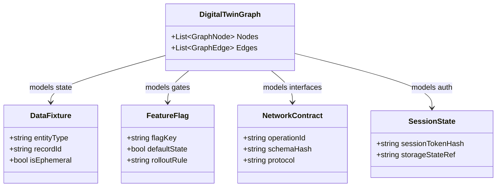
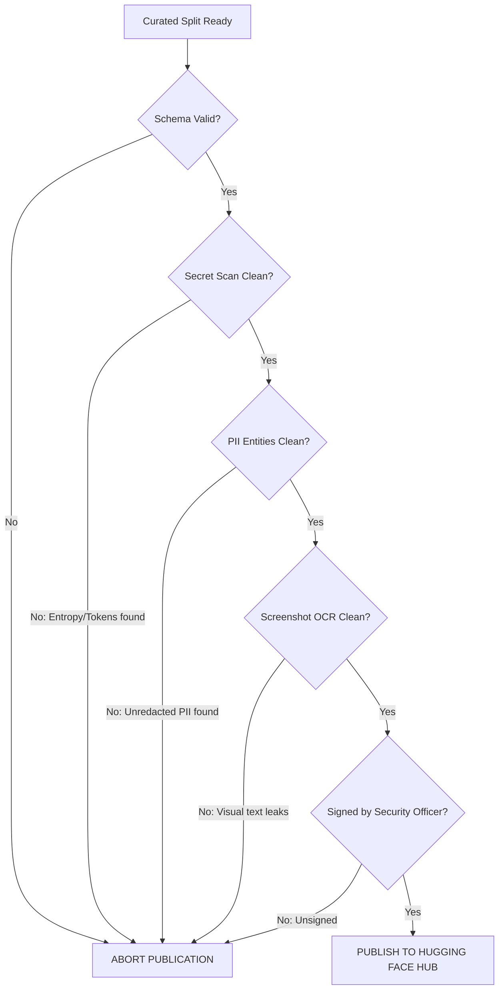

# Playwright Intelligence Ecosystem: Comprehensive Architecture, Security, Data & Benchmark Review

> **Review Board:** Distinguished AI Architect, Principal ML Engineer, Principal Security Engineer, Data Platform Architect, and Staff Quality Engineering Platform Reviewer  
> **System Under Review:** `Autonomous-Bug-Hunter-Playwright`  
> **Core Principle:** *"AI proposes. The engine verifies."*  
> **Scale Target:** 25,000+ curated records, public Hugging Face assets, enterprise CI/CD adoption.

---

## Executive Summary & System-Level Assessment

The `Autonomous-Bug-Hunter-Playwright` platform has a solid architectural foundation: the explicit decoupling of cognitive proposals (AI) from deterministic execution and verification (.NET 9 engine, Playwright CDP worker, delta-debugging step minimization).

However, as the system transitions from a prototype into an **Enterprise AI Data & Model Platform (PIP $\rightarrow$ PFD $\rightarrow$ PIB $\rightarrow$ PIM)**, significant data platform, security, and benchmark gaps must be addressed *before* large-scale data ingestion begins. 

This review delivers an unvarnished audit across 11 core dimensions, providing concrete schema expansions, governance controls, and a hardened roadmap to ensure long-term competitive defensibility.

---

## PART 1: Playwright Failure Dataset (PFD) Review

### 1.1 Critical Missing Fields & Future Model Demands
While `PFD-v1.0` captures basic failure metadata, future Small Language Models (SLMs) and dense encoders (e.g. ModernBERT) will fail to differentiate subtle failure modes without the following five data dimensions:

1. **`precedingActionTrail` (Temporal Horizon):**
   - *Current Gap:* The schema only records `workflow.stepIndex`.
   - *Future Model Need:* Models cannot differentiate `TimingIssue` from `LocatorDrift` without knowing what happened in the preceding 3–5 user actions (e.g., did an AJAX call trigger 50ms before this click? Did an animation begin?).
   - *Recommendation:* Capture the last 5 executed atomic actions with relative timestamps ($\Delta t$).

2. **`domFragmentAtFailure` (Local Structural Context):**
   - *Current Gap:* Only `axTreeSnippet` is captured.
   - *Future Model Need:* Accessibility trees omit critical CSS properties (`display: none`, `visibility: hidden`, `opacity: 0`, `z-index: 9999`, `pointer-events: none`). If an element is in the AXTree but obscured by a modal backdrop or unhydrated React tree, an AXTree-only model will falsely predict `LocatorDrift` instead of `TimingIssue` or `VisualRegression`.
   - *Recommendation:* Capture the outerHTML fragment of the target node and its direct parent/siblings (sanitized up to 2KB).

3. **`clientFrameworkState` (Hydration & SPA Context):**
   - *Current Gap:* Zero framework telemetry.
   - *Future Model Need:* 40%+ of modern Playwright flakiness stems from SPA hydration mismatches (e.g. Next.js, React 19 concurrent mode, Vue 3).
   - *Recommendation:* Capture `isHydrated: boolean`, `framework: "nextjs" | "react" | "angular" | "vue" | "vanilla"`, and `activeXhrCount: integer`.

4. **`imageEmbeddingSiglip` (Multimodal Feature Compression):**
   - *Current Gap:* Screenshots are stored as file paths on disk.
   - *Future Model Need:* Multimodal model training cannot afford to load 25,000 uncompressed 1080p PNG images into GPU VRAM during training batches.
   - *Recommendation:* Compute and store a normalized 768-dimensional SigLIP/CLIP dense vector embedding alongside screenshot metadata.

5. **`digitalTwinContext` (Knowledge Graph Anchors):**
   - *Current Gap:* The dataset is disconnected from the Digital Twin graph nodes.
   - *Recommendation:* Store `graphStateId`, `expectedApiDependencies`, and `activeRbacRole` directly on the failure record.

---

## PART 2: Action Intent Dataset (AID) Review

### 2.1 Taxonomy Evaluation
The initial 12-intent taxonomy covers basic consumer storefront paths, but is inadequate for Enterprise B2B SaaS, which accounts for the vast majority of enterprise quality engineering budgets.

#### Missing Intent Classes (Expanding from 12 to 20):
1. `upload_file` (Critical for document workflows, avatars, CSV imports)
2. `download_export` (Report generation, PDF verification)
3. `reorder_drag_and_drop` (Kanban boards, list sorting)
4. `expand_accordion_tree` (Hierarchical configuration trees, sidebars)
5. `multi_select_batch_action` (Table bulk selection, bulk delete)
6. `switch_tenant_workspace` (Multi-tenant enterprise context switching)
7. `dismiss_alert_toast` (Dismissing notification banners)
8. `switch_tab_view` (Switching sub-navigation panels)

### 2.2 Missing Contextual Telemetry in AID
- **Form State Topology:** Is the form pristine, dirty, valid, or invalid? An intent to click "Submit" when required inputs are empty represents an entirely different test intent than clicking it on a valid form.
- **Prior Action Token:** `intent` cannot be determined in isolation. A button named "Confirm" preceded by "Delete User" indicates `confirm_destructive_action`; preceded by "Enter Credit Card" indicates `complete_checkout`.

---

## PART 3: Digital Twin Graph Review

### 3.1 Entity Model Additions
The current 9 entities (`Page`, `Action`, `Workflow`, `Api`, `Component`, `Role`, `Risk`, `Failure`, `Locator`) represent the UI and API well, but fail to represent dynamic state and infrastructure.



### 3.2 Missing Graph Relationships
1. `MUTATES` (`Action` $\rightarrow$ `DataFixture`): Indicates that clicking "Checkout" decrements inventory.
2. `GOVERNED_BY` (`Workflow` / `Api` $\rightarrow$ `FeatureFlag`): Explains why a path was suddenly unavailable (flag turned off, not a broken route).
3. `INVALIDATES` (`Action` $\rightarrow$ `SessionState`): Logout or permission update events.
4. `SHADOWS` (`Component` $\rightarrow$ `Component`): Modals or tooltips overlaying interactable components.

---

## PART 4: Playwright Intelligence Benchmark (PIB) Review

### 4.1 Missing Benchmark Tasks
The 3 existing tasks (Root Cause Classification, Failure Similarity Retrieval, Action Intent Prediction) evaluate only static model inference. A genuine Quality Engineering platform must evaluate **agentic execution and deterministic remediation**.

#### Proposed Extended PIB Task Suite (PIB-v2.0):

| Task ID | Task Name | Evaluation Objective | Target Metric | Minimum Pass Gate |
|---|---|---|---|:---:|
| **PIB-T1** | Root Cause Classification | 8-class taxonomy prediction from logs & traces | Macro-F1 & ECE (Calibration) | $\ge 0.88$ F1, $\text{ECE} \le 0.08$ |
| **PIB-T2** | Failure Similarity Retrieval | Retrieve identical root-cause incidents (Hard Negatives) | MRR@10 & NDCG@5 | $\text{MRR} \ge 0.78$ |
| **PIB-T3** | Action Intent Prediction | Predict next semantic action from AXTree | Top-1 & Top-3 Accuracy | $\ge 84\%$ Top-1 |
| **PIB-T4** | **Self-Healing Success Rate** | Synthesize AST patch; re-run Playwright without error | Replay Pass Rate (2 of 2 runs) | $\ge 85\%$ |
| **PIB-T5** | **Exploration State Recall** | Discover unique app states compared to ground-truth | State Space Recall % | $\ge 90\%$ |
| **PIB-T6** | **Blast Radius Precision** | Predict impacted workflows given code diff | Precision & Recall vs Git Diff | $\ge 80\%$ |

---

## PART 5: Model Roadmap Review & Career Positioning

### 5.1 Roadmap Validation
Current Sequence:
`Model 1: Root Cause Classifier` $\rightarrow$ `Model 2: Similarity Embeddings` $\rightarrow$ `Model 3: Action Intent Model`.

**Architectural Verdict:** The sequence is sound, but Model 1 and Model 2 **should be merged into a unified Multi-Task Encoder**.
- *Rationale:* Both Root Cause Classification and Similarity Retrieval ingest the exact same input modality (error traces, network summaries, console logs).
- Fine-tuning a single `ModernBERT` base using combined Cross-Entropy loss (classification) and Triplet Margin loss (embeddings) cuts training compute by 50% and eliminates dual-model latency in CI.

### 5.2 Public vs. Proprietary Data Partition
To establish an unassailable commercial and intellectual moat:
- **Public on Hugging Face (Open Core):** 5,000–10,000 sanitized failures and AXTree intent records collected from open-source web applications (Conduit, Spree, Ghost, TodoMVC, DemoHotel, DemoShop). Establishes authority and community adoption.
- **Proprietary Vault (Enterprise Moat):** Graph Digital Twin structural topologies, multi-tenant RBAC attack vectors, proprietary enterprise defect distributions, and AST patch history.

---

## PART 6: Moat Analysis

```
+----------------------------------------------------------------------------------------------------+
|                                    WHAT IS NOT A MOAT (COMMODITY)                                  |
|   • OpenAI / Claude API prompt wrappers ("Ask ChatGPT why this test failed")                      |
|   • Basic Playwright test scripters and recorded test suites                                       |
|   • Generic fine-tuned models trained on synthetic or uncurated error dumps                        |
+----------------------------------------------------------------------------------------------------+
                                                  │
                                                  ▼
+----------------------------------------------------------------------------------------------------+
|                                      THE DURABLE ENTERPRISE MOAT                                   |
|   1. The Ground-Truth Dataset (PFD): 25k+ verified records with deterministic double-replay proof. |
|   2. The Deterministic Verification Gate: "AI proposes, the engine verifies" (no unverified findings)|
|   3. Living Application Digital Twin: Graph memory tracking evolving state machines across releases|
|   4. The Benchmark (PIB): Defining the industry benchmark standard for Quality Engineering AI.     |
+----------------------------------------------------------------------------------------------------+
```

---

## PART 7: Privacy, Security & Data Governance Review

> [!CAUTION]
> If unredacted Playwright traces or screenshots are exported to Hugging Face or shared with customers, catastrophic leaks of PII, session tokens, and cloud infrastructure secrets will occur.

### 7.1 Attack Vectors & Sensitive Data Inventory
1. **Network Authorization Headers:** `Authorization: Bearer <JWT>`, `Cookie: session_id=...`, `X-Api-Key`.
2. **Form Input Payloads in Traces:** Customer passwords, credit cards (PAN/CVV), social security numbers, physical addresses entered during exploration.
3. **Database & Infrastructure Leakage in 500 Responses:** Stack traces exposing internal hostnames (`k8s-pod-12.internal.corp`), SQL statements, DB connection strings (`User=postgres;Password=...`).
4. **Visual PII in Screenshots:** Profile avatars, billing tables, invoice PDFs rendered in Chromium canvas.

---

## PART 8: Hardened Sanitization Pipeline & Schema Governance

The current boolean status (`piiScanPassed: true`) is **insufficient for enterprise compliance (GDPR, SOC2, HIPAA)**. It lacks cryptographic auditability and granular failure attribution.

### 8.1 Hardened Governance Schema (`governanceMetadata`)
```json
{
  "governanceMetadata": {
    "schemaVersion": "gov-v1.0",
    "piiScan": {
      "status": "PASSED",
      "scannerVersion": "presidio-4.1.0",
      "scannedAt": "2026-11-07T12:00:00Z",
      "redactionsCount": 3,
      "redactedEntityTypes": ["EMAIL_ADDRESS", "IP_ADDRESS"]
    },
    "secretScan": {
      "status": "PASSED",
      "scannerVersion": "trufflehog-3.82.0",
      "entropyThreshold": 4.5,
      "secretsDetected": 0
    },
    "screenshotAudit": {
      "status": "PASSED",
      "ocrScanned": true,
      "visualPiiRedacted": false,
      "auditedBy": "reviewer_sec_99"
    },
    "publicationApproval": {
      "approvedForInternalTraining": true,
      "approvedForPublicRelease": false,
      "signedBy": "security-officer-hash",
      "decisionTimestamp": "2026-11-07T12:05:00Z"
    }
  }
}
```

---

## PART 9: Screenshot Governance & OCR Redaction

Screenshots cannot be approved for public release simply because an error log is clean. Text rendered directly on the browser canvas regularly leaks sensitive customer records.

### 9.1 Mandatory `screenshotReviewPassed` Criteria
To achieve `screenshotAudit.status = "PASSED"`, an artifact must satisfy four deterministic gates:
1. **Automated OCR Sweep:** Run Tesseract / PaddleOCR over the image canvas. Extracted text must pass regex scanners for credit card patterns (Luhn algorithm), email addresses, phone numbers, and SSNs.
2. **Bounding Box Masking:** Automated black-box pixel masking applied over coordinates associated with `<input type="password">`, `<input type="email">`, and billing containers identified via the accessibility tree.
3. **Internal Hostname Watermark Strip:** Obfuscation of browser address bar URL parameters containing internal staging domains.
4. **Human Reviewer Sign-Off:** Explicit verification by an authorized security reviewer before public release flag is toggled.

---

## PART 10: Hugging Face Publication Gate

An automated pre-flight gate must be enforced in CI/CD before any dataset export (`export_to_hf.py`) is allowed to publish to the Hugging Face Hub.



---

## PART 11: Automated Dataset Validation Service Architecture

Implemented as an automated Python / C# validation service executing before split generation and export.

### 11.1 Validation Checkpoints & Quality Report
- **Schema & Type Check:** Strict JSON Schema Draft 2020-12 compliance.
- **Entropy & Secret Detection:** Regex + Shannon entropy checks on all string values.
- **Taxonomy Balance Check:** Enforces that no single class exceeds 35% of the total dataset (prevents model collapse).
- **Near-Duplicate Detection:** MinHash LSH on error signatures to prevent data leakage between train and test splits.
- **Dataset Drift Detector:** Population Stability Index (PSI) tracking shift between dataset versions (`PFD-v1.0` vs `PFD-v2.0`).

---

## Synthesis of Review Outputs

### 1. Architecture Strengths
- Uncompromising adherence to *"AI proposes, the engine verifies"* is designed so that unverified model output does not enter the dataset or bug reports.
- Clean bounded contexts in .NET 9 API with decoupled Node.js CDP worker daemon.
- Property graph modeling of the application twin bridging static code and runtime execution.

### 2. Architecture Weaknesses
- Failure records lack temporal action context (what happened 5 steps prior).
- DOM snapshots are missing computed styles and hydration flags, risking misclassification of timing issues.
- Digital Twin lacks data fixture and feature flag entities.

### 3. Top 3 Risks
1. **Secret & PII Leakage:** Accidental publication of unredacted JWTs or canvas screenshots to Hugging Face Hub.
2. **Dataset Contamination / Leakage:** Duplicate failure signatures appearing in both `train.jsonl` and `test.jsonl` due to un-hashed stack traces.
3. **Taxonomy Imbalance:** Over-representation of `LocatorDrift` (easy to collect) starving complex categories (`TestDataFailure`, `TimingIssue`).

### 4. Missing Telemetry
- `precedingActionTrail`: Last 5 atomic actions with timestamps.
- `domFragmentAtFailure`: Local DOM neighborhood with computed styles.
- `clientFrameworkState`: Hydration status and active XHR count.
- `imageEmbeddingSiglip`: 768-dim dense visual vectors for fast multimodal training.

### 5. Missing Labels
- `flakinessScore`: Ratio of passes to runs under identical seeds.
- `rootCauseConfidenceCalibration`: Brier score targets for model calibration.
- `hardNegativeClass`: Discrimination rationale in similarity triplets.

### 6. Missing Graph Entities
- `DataFixture`, `FeatureFlag`, `NetworkContract`, `SessionState`.

### 7. Missing Graph Relationships
- `MUTATES`, `GOVERNED_BY`, `INVALIDATES`, `SHADOWS`.

### 8. Missing Benchmark Tasks
- `SelfHealingSuccessRate` (PIB-T4), `ExplorationStateRecall` (PIB-T5), `BlastRadiusAccuracy` (PIB-T6).

### 9. Missing Governance Controls
- Cryptographic reviewer signatures on public release approvals.
- Population Stability Index (PSI) dataset drift validation.

### 10. Privacy & Security Concerns
- Unmasked authorization headers in HAR traces.
- Canvas text rendering PII in screenshots.
- Unsanitized internal database hostnames in 500 stack traces.

### 11. Recommended Schema Additions
- Upgrade to `PFD-v2.0` schema adding `precedingActionTrail`, `domFragmentAtFailure`, `governanceMetadata`, and `imageEmbeddingSiglip`.

### 12. Recommended API Additions
- `POST /api/dataset/validate`: Automated Dataset Quality & Security Report.
- `POST /api/dataset/redact`: Multi-stage automated PII/secret sanitizer.

### 13. Recommended Benchmark Enhancements
- Integrate expected calibration error (ECE) and deterministic double-replay healing pass rate into `pib_evaluator.py`.

### 14. Recommended Validation Services
- Implement `ai/pipelines/dataset_validator.py` with MinHash deduplication, secret scanning, and automated Hugging Face pre-flight gates.

---

## Top 10 Actions to Complete BEFORE Collecting 10,000 Records

```
 1. [CRITICAL] Implement automated multi-stage PII & Secret Redaction pipeline (Presidio + TruffleHog).
 2. [CRITICAL] Update PFD schema to v2.0 to capture precedingActionTrail and domFragmentAtFailure.
 3. [DATASET] Implement MinHash LSH deduplication to prevent identical error signatures across train/test splits.
 4. [GOVERNANCE] Transition governanceStatus from booleans to audit enums with reviewer signatures.
 5. [SECURITY] Deploy automated OCR scanning & input-masking on all captured failure screenshots.
 6. [BENCHMARK] Add Self-Healing Success Rate (PIB-T4) and Calibration Error (ECE) to pib_evaluator.py.
 7. [DIGITAL TWIN] Add DataFixture and FeatureFlag entities and MUTATES relationships to TwinGraph.cs.
 8. [ML PIPELINE] Precompute and store SigLIP dense embeddings for screenshots to avoid training VRAM bottlenecks.
 9. [CURATION] Implement class-balancing quotas in dataset_manager.py to prevent LocatorDrift over-representation.
10. [HUGGING FACE] Build automated publication pre-flight gate script blocking un-audited dataset uploads.
```
