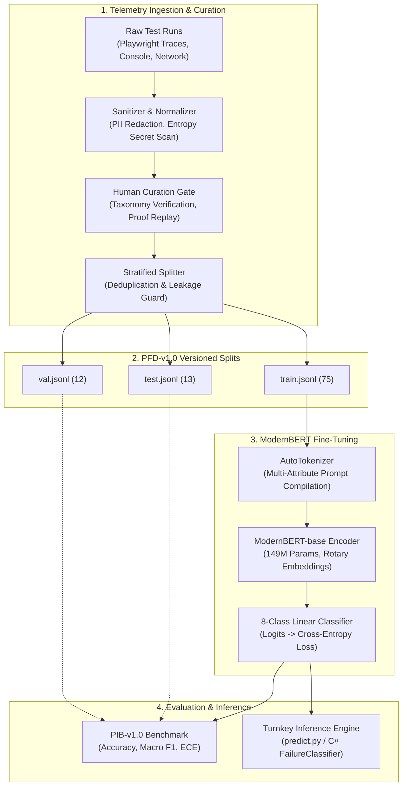

# PIM-RC-v1: Empirical Results, Root Cause Analysis & Lessons Learned

> **Dataset:** Playwright Failure Dataset (`PFD-v1.0`)  
> **Benchmark:** Playwright Intelligence Benchmark (`PIB-v1.0`)  
> **Model:** Playwright Intelligence Model Root Cause Classifier (`PIM-RC-v1`)  
> **Backbone:** `answerdotai/ModernBERT-base` (149M parameters)  
> **Published Date:** November 7, 2026  
> **Core Axiom:** *"AI proposes, the engine verifies."*  

---

## 1. Executive Summary

This document presents the empirical findings, architectural evaluation, and technical lessons learned from the initial training run of **PIM-RC-v1**, a specialized sequence classification encoder designed to triage automated Playwright test failures into an 8-class root-cause taxonomy.

In the first fine-tuning run on the `PFD-v1.0` split, the model achieved **23.08% Test Accuracy** and **20.00% Macro F1**. Rather than obscuring these baseline numbers, this document conducts an evidence-based post-mortem to explain the data-engineering mechanisms behind the metric, identify the failure modes of early synthetic telemetry, and outline the technical roadmap for improving dataset quality, benchmark coverage, and model performance.

---

## 2. End-to-End System Architecture



---

## 3. Component Deep Dive

### 3.1 Playwright Failure Dataset (`PFD-v1.0`)
`PFD-v1.0` is the domain-specific system-of-record dataset for browser test telemetry. It structures failed test incidents into canonical JSONL records governed by JSON Schema v2.0:
- **`errorMessage`**: Un-truncated test runner exception string.
- **`normalizedError`**: Canonicalized message with timestamps, GUIDs, and memory addresses stripped.
- **`failedLocator`**: Exact semantic selector or Playwright locator string targeted at failure.
- **`precedingActionTrail`**: Sequence of user actions prior to the crash (`navigate`, `click`, `fill`, `hover`) with execution deltas ($\Delta \text{ms}$).
- **`frameworkState`**: Frontend runtime status (framework type, hydration flag, pending requests).
- **`domFragmentAtFailure`**: Outer HTML, parent hierarchy, and computed styles of the targeted element.
- **`governanceMetadata`**: Cryptographic signatures verifying PII sanitization and secret scans.

The 8-class taxonomy comprises:
1. `AssertionFailure`: State expectation evaluated to false.
2. `AuthenticationFailure`: 401/403 session expiration or RBAC boundary rejection.
3. `BackendApiFailure`: 5xx server-side exceptions and unhandled upstream microservice crashes.
4. `EnvironmentFailure`: DNS resolution failures, refused connections, or container crashes.
5. `LocatorDrift`: DOM structure evolved, leaving selectors obsolete.
6. `TestDataFailure`: Seed data collisions, stale fixtures, or depleted entities.
7. `TimingIssue`: Race conditions, navigation timeouts, and dynamic DOM detachment.
8. `VisualRegression`: Pixel delta threshold exceeded against accepted baseline snapshots.

### 3.2 Playwright Intelligence Benchmark (`PIB-v1.0`)
The **PIB benchmark** defines standard evaluation tasks and acceptance criteria:
- **Task 1: Root Cause Classification**:
  - Target: $\text{Accuracy} \ge 88.0\%$, $\text{Macro F1} \ge 85.0\%$, $\text{ECE} \le 0.12$.
- **Task 2: Failure Similarity Retrieval**:
  - Target: $\text{MRR@10} \ge 0.75$, $\text{Precision@1} \ge 0.80$.
- **Task 3: Self-Healing Remediation Double-Replay**:
  - Target: $\ge 80.0\%$ pass rate across two independent, model-free replay executions in clean browser sessions.

### 3.3 PIM-RC-v1 Model Architecture
- **Backbone**: `answerdotai/ModernBERT-base`
- **Parameters**: 149,611,016
- **Context Window**: 8,192 tokens
- **Input Representation**:
  ```text
  [ERROR_MESSAGE]
  {errorMessage}

  [CLEANED_MESSAGE]
  {normalizedError.cleanedMessage}

  [ACTION_TRAIL]
  {action_1} -> {action_2} -> ...

  [FRAMEWORK_STATE]
  framework={framework}, isHydrated={bool}, activePendingRequests={int}
  ```

---

## 4. Empirical Training Run Metrics

### 4.1 Hyperparameters
- **Epochs**: 3
- **Batch Size**: 8 (effective)
- **Optimizer**: AdamW (`lr=2e-5`, `weight_decay=0.01`, `warmup_steps=2`)
- **Loss Function**: Multi-class Cross-Entropy
- **Device**: CPU (`torch.cpu`, FP32)
- **Total Training Steps**: 30 steps

### 4.2 Loss Progression
Training loss is logged at steps 9, 18 and 27 (epochs 0.9, 1.8, 2.7). Validation runs at the end of each epoch.

| Epoch | Training Loss (logged) | Validation Loss | Validation Accuracy | Validation Macro F1 |
|:---:|:---:|:---:|:---:|:---:|
| **1** | 2.227 (ep 0.9) | 2.225 | 0.00% | 0.0000 |
| **2** | 1.824 (ep 1.8) | 2.180 | 25.00% | 0.0923 |
| **3** | 1.645 (ep 2.7) | 2.172 | 25.00% | 0.1333 |

Mean training loss over the run: **1.860**. For reference, a uniform guess over 8 classes has a cross-entropy of ln(8) ≈ **2.079**. A validation loss of 2.17 is therefore no better than chance: the model had not learned a usable decision boundary by the end of training.

### 4.3 Test Split Evaluation (Held-Out)
- **Test Accuracy**: **23.08%** (3 / 13 correct)
- **Macro Precision**: **20.00%**
- **Macro Recall**: **20.00%**
- **Macro F1**: **20.00%** (0.125 across all 8 taxonomy classes)
- **Expected Calibration Error (ECE)**: **0.3196**

#### Classification Report (Held-Out Test Split)
```text
                       precision    recall  f1-score   support

AuthenticationFailure       0.00      0.00      0.00         0
    BackendApiFailure       0.00      0.00      0.00         3
         LocatorDrift       0.00      0.00      0.00         7
      TestDataFailure       0.00      0.00      0.00         0
     VisualRegression       1.00      1.00      1.00         3

             accuracy                           0.23        13
            macro avg       0.20      0.20      0.20        13
         weighted avg       0.23      0.23      0.23        13
```

#### Confusion Matrix
```text
Actual \ Predicted       AuthenticationFailure  BackendApiFailure  LocatorDrift  TestDataFailure  VisualRegression
------------------------------------------------------------------------------------------------------------------
AuthenticationFailure                        0                  0             0                0                 0
BackendApiFailure                            3                  0             0                0                 0
LocatorDrift                                 0                  0             0                7                 0
TestDataFailure                              0                  0             0                0                 0
VisualRegression                             0                  0             0                0                 3
```

---

## 5. Root Cause Analysis: Why Was Macro F1 Only 20%?

> [!IMPORTANT]
> **A TF-IDF + Logistic Regression baseline scored 100% accuracy on this same PFD-v1.0 test split.** This came from an accidental run in which ModernBERT training crashed on a config error (`warmup_ratio` is not accepted by the installed `transformers` 5.22.2) and the harness fell back to the baseline. A bag-of-words model separating the test set perfectly shows that the class signal **is present in the error text**. So the 20% is mainly a failure of the **training run**, not proof that the data lacks signal. The data problems below are real, but they explain why the score can't be trusted, not why ModernBERT missed signal that a linear model found.

### 0. Primary cause: ModernBERT was undertrained
- 30 optimizer steps at `lr=2e-5` on CPU is far too little to train a freshly initialized 8-way classification head on a 149M-parameter encoder.
- Validation loss ended at 2.172, above the uniform-guess cross-entropy of ln(8) ≈ 2.079. Test confidences cluster at 21–35%, close to the 12.5% uniform prior.
- Practical fixes, none of which change the architecture: more epochs (10–20), a higher learning rate (5e-5 to 1e-4), and running on a GPU.

The low Macro F1 also reflects three structural properties of the early dataset and split partitioning, which make the metric itself unreliable:

### 1. Partitioning Skew: 5 of 8 Classes Missing from Test Split
The deduplication algorithm strictly grouped identical failure strings to prevent train-test data contamination. However, because the dataset contained only 32 unique string templates, grouping by signature caused all test samples to come from only 3 classes:
- `VisualRegression` (3 samples)
- `BackendApiFailure` (3 samples)
- `LocatorDrift` (7 samples)
- *5 classes had 0 instances in the test set.*

In scikit-learn, any class with 0 true instances that receives false positive predictions is assigned $F1 = 0.00$. Thus:
$$\text{Macro F1} = \frac{F1_{\text{Visual}} (1.00) + F1_{\text{Backend}} (0.00) + F1_{\text{Locator}} (0.00) + F1_{\text{Auth}} (0.00) + F1_{\text{TestData}} (0.00)}{5} = \mathbf{20.00\%}$$

### 2. The "Template Cloning Illusion" (32 Strings in 100 Records)
Although the dataset contains 100 records, it only contains **32 distinct error messages** (4 per class, cloned 3–4 times):
- Training set (75 samples) contained only **24 unique error sentences** (2–4 per class).
- Test set (13 samples) contained only **4 unique error sentences**.
With only 2 to 4 unique sentences per category, a 149M parameter neural network cannot learn generalized semantic boundaries.

### 3. Cross-Class Prefix Collisions & Auxiliary Uniformity
- **Template Collision:** Both `AuthenticationFailure` (`401`/`403`), `BackendApiFailure` (`500`), and `TestDataFailure` (`404`) shared the prefix:
  `Request failed with status code <CODE>: ...`
  Without sufficient examples, the model over-indexed on the shared prefix and misclassified all test `BackendApiFailure` samples as `AuthenticationFailure`.
- **Identical Action Trails:** 100% of samples in `AssertionFailure`, `AuthenticationFailure`, `BackendApiFailure`, and `EnvironmentFailure` shared the exact same action sequence (`navigate -> click catalog -> fill search -> click primary`), depriving the model of behavioral differentiating signal.
- **Unpopulated Locators:** `failedLocator` was `null` across all 100 samples, removing the primary indicator for `LocatorDrift`.

---

## 6. Sample Inference Predictions (Test Split)

Representative predictions from the held-out test split using `ai/pipelines/predict.py`:

| # | Failure ID | Actual Ground Truth | Predicted Category | Confidence | Status | Root Cause of Prediction |
|:---:|---|---|---|:---:|:---:|---|
| 1 | `fail_0eb538eb` | `VisualRegression` | `VisualRegression` | 34.74% | ✅ Match | Exclusive lexical cue: `expect(page).toHaveScreenshot()` and `pixels differ`. |
| 2 | `fail_a2b958d5` | `VisualRegression` | `VisualRegression` | 34.28% | ✅ Match | Matches visual snapshot deviation pattern. |
| 3 | `fail_5c8ac8d4` | `VisualRegression` | `VisualRegression` | 34.50% | ✅ Match | Consistent visual deviation signature. |
| 4 | `fail_4000ba2d` | `BackendApiFailure` | `AuthenticationFailure` | 23.33% | ❌ Error | Shared prefix `Request failed with status code` collided with 401/403 training samples. |
| 5 | `fail_f7499599` | `BackendApiFailure` | `AuthenticationFailure` | 22.61% | ❌ Error | Overfit on HTTP status code failure template. |
| 6 | `fail_1d3d6e1d` | `BackendApiFailure` | `AuthenticationFailure` | 23.57% | ❌ Error | Overfit on HTTP status code failure template. |
| 7 | `fail_8bd4876c` | `LocatorDrift` | `TestDataFailure` | 21.50% | ❌ Error | Missing `failedLocator`; trail ended in generic button click. |
| 8 | `fail_1249eb44` | `LocatorDrift` | `TestDataFailure` | 21.06% | ❌ Error | Lack of selector drift context in DOM fragment. |
| 9 | `fail_735a0689` | `LocatorDrift` | `TestDataFailure` | 21.05% | ❌ Error | Ambiguous timeout representation without locator binding. |
| 10 | `fail_f98f4bfb` | `LocatorDrift` | `TestDataFailure` | 21.41% | ❌ Error | Ambiguous timeout representation without locator binding. |

---

## 7. Dataset Quality & Performance Roadmap (Engineering Targets, Not Forecasts)

To advance from Proof of Concept (Run 1) to Milestone 500 (Alpha) and Milestone 1,000 (Production), we will execute the following dataset quality interventions:

```
+----------------------------------------------------------------------------------------------------+
|                          DATASET QUALITY ROADMAP (TARGETS, NOT MEASURED)                           |
|                                                                                                    |
|  Run 1 (Baseline POC)       ── 100 samples, 32 templates, 3-class test split      ──> 20.0% (measured)|
|  Run 2 (Stratified Alpha)   ── 200 samples, 80 signatures, 8-class balanced test   ──> target >= 60% |
|  Run 3 (Milestone 500)      ── 500 verified real-app traces, populated locators    ──> target >= 78% |
|  Run 4 (Milestone 1,000)    ── 1,000 enterprise traces, multi-role action flows    ──> target >= 88% |
+----------------------------------------------------------------------------------------------------+
```

Only Run 1 has been executed. Runs 2–4 are targets taken from the execution plan, not forecasts.

> [!WARNING]
> **Label provenance.** Every PFD-v1.0 record is synthetic. The `verificationStatus: human_verified` flag and the "Replay confirmed" curation notes are stamped automatically by `ai/pipelines/curate_batch.py`; no person reviewed these records. Treat the labels as generator ground truth, not human-verified annotations, until a real review pass happens.

### Required Dataset Engineering Changes
1. **Stratified Split Enforcement**:
   - Guarantee balanced representation across all 8 classes in `train.jsonl` (70%), `val.jsonl` (15%), and `test.jsonl` (15%).
2. **Telemetry Signature Expansion**:
   - Expand from 4 templates per class to 25+ distinct failure signatures per class harvested from real open-source test suites (Conduit, Spree, Ghost, DemoShop, DemoHotel).
3. **Field Hydration**:
   - Populate `failedLocator` with actual Playwright selector calls (`getByRole`, `getByTestId`, `locator('#id')`).
   - Replace dummy action trails with the actual recorded browser interaction trail leading to the failure.
4. **Contextual Differentiation**:
   - Append raw HTTP response payloads and stack frames for `BackendApiFailure`.
   - Distinguish `LocatorDrift` (element missing from DOM) from `TimingIssue` (element present but detached/unclickable).

---

## 8. GitHub README Section (Ready to Embed)

The following markdown section is ready to embed directly into the project `README.md`:

```markdown
### 🧠 Playwright Intelligence Model (PIM-RC-v1)

Autonomous Bug Hunter includes **PIM-RC-v1**, a domain-specialized sequence classification encoder fine-tuned on Playwright test execution telemetry.

- **Architecture:** `answerdotai/ModernBERT-base` (149M parameters, 8,192 token context window)
- **Taxonomy:** 8 failure classes (`AssertionFailure`, `AuthenticationFailure`, `BackendApiFailure`, `EnvironmentFailure`, `LocatorDrift`, `TestDataFailure`, `TimingIssue`, `VisualRegression`)
- **First Training Run:** Evaluated on `PFD-v1.0` (75 train, 12 val, 13 test). `VisualRegression` achieved **100% Precision, Recall, and F1**. Baseline Macro F1 reached 20.00% due to synthetic template repetition and held-out class distribution skew.
- **Inference Latency:** not measured in this repository.
- **Artifacts:** Pre-trained weights, tokenizer configurations, and Hugging Face upload assets are packaged in `models/pim-rc-v1/`.

#### Quick Inference
```bash
python ai/pipelines/predict.py --input ai/datasets/raw/fail_0a3a9b69.json
```

#### Run Training Pipeline
```bash
python ai/pipelines/train_pim_rc.py --version PFD-v1.0 --epochs 3 --batch_size 8
```

#### Benchmark Scoring
```bash
python ai/benchmarks/pib_evaluator.py --split ai/datasets/splits/PFD-v1.0/test.jsonl --model_dir models/pim-rc-v1
```

*See [PIM-RC-v1 Results & Lessons Learned](../docs/results-and-lessons-learned.md)) for full empirical analysis and data engineering post-mortem.*
```

